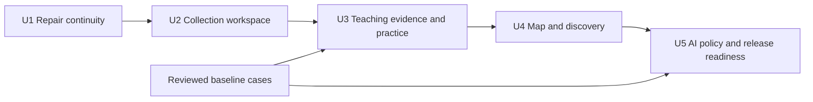

# Roadmap to a coherent Second Brain learning journey

Date: **2026-10-09**  
Status: **Execution started following user continuation: U1 implemented in development, with remaining visual/accessibility acceptance open. U2–U5 remain target work. The original audit delivery changed no application code.**  
Specification checkpoint: [GitHub #29](https://github.com/CloudKai/secondBrain/issues/29), **ready-for-agent**, with a [local specification](ideal-learning-app-spec.md). U1 delivery: [#30](https://github.com/CloudKai/secondBrain/issues/30), migration 018 applied after approval. See [development acceptance](../reviews/learning-continuity-acceptance-2026-10-09.md).
Basis: [Evidence-based audit](../reviews/ideal-learning-app-audit-2026-10-09.md), reviewed HEAD `1835298305d50f6a9042a1ef9b7c4a56c8ca242e` plus the documented local working tree.  
Existing work: [Learning specification](topic-learning-journey-spec.md), [web tracker](../../context/web-progress-tracker.md), [GitHub #28](https://github.com/CloudKai/secondBrain/issues/28).

## 1. Outcome and boundaries

The learner should be able to save or discover material, choose an editable goal, learn through a coherent sequence, practise, retain their work and see how their concepts connect. One source can start a journey. More sources should improve its evidence and structure through a contribution preview the learner confirms.

**Current development capabilities:** saved source notes and exact evidence; topic organization; hybrid retrieval; learning previews and confirmed plans; up to eight supporting sources per plan; retained attempts and difficulty/goal branches; selected plan/lesson restoration inside the source-rooted flow. Feedback is provisional.

**Target additions in this plan:** an independent collection workspace; reliable library resume and unified activity; durable drafts/conversations; retrieval across captures for teaching; stable outcomes; useful next actions; broader map navigation; gap-specific discovery; consistent AI policy and operational release gates.

This plan does not introduce a universal syllabus, claim mastery from reading, silently change goals, regenerate all existing notes, replace the retrieval provider or require a new grounding classifier. Mobile/iOS remains outside these units. English remains the initial language. No TinyFish integration is included.

## 2. Learner experience to build

1. **Start:** save a source or describe a topic. A topic without saved evidence can offer discovery and a suggested direction, clearly labelled as not yet source-covered.
2. **Choose:** review a few supported starting paths and an editable goal; confirm a path.
3. **Learn:** enter a focused lesson with an outcome, concise explanation, relevant example, exact evidence and practice.
4. **Respond:** save unfinished work automatically; receive criterion-specific provisional feedback; choose a hint, retry, prerequisite, evidence inspection or continuation.
5. **Return:** Library resumes the same collection, path, revision, lesson and draft. Reading and navigation do not award understanding.
6. **Expand:** a gap can open discovery. Save a candidate into the chosen collection. Preview its contribution before changing a plan. Keep older attempts and goals inspectable.
7. **Orient:** the learning path shows chosen sequence/activity; the topic map shows source-supported concepts and broader groups. Suggested branches are visibly and accessibly separate until confirmed.

Keep the charcoal/mint identity and existing light theme. Prioritize one main task in the workspace. Place full maps, source management, revision details and historical work behind clear secondary controls. All actions must remain available without pointer hover or graph dragging.

## 3. Proposed domain model and compatibility rules

All names and API additions in this section are **proposals**, not existing contracts.

| Entity | Meaning and identity rule |
| --- | --- |
| Source/version | Original saved capture and immutable provenance. Existing IDs, offsets, page numbers and timestamps remain authoritative. |
| Collection | Owned learning destination with title, current stated goal and source membership; independent of a source being present. |
| Path | A chosen direction within a collection. Goal branches retain a link to their origin without overwriting that origin's goal. |
| Plan revision | Immutable teaching proposal/confirmation for a path and difficulty, using an explicit bounded evidence set. One current confirmed revision per path; previous levels/revisions remain selectable as history or explicit reactivation. |
| Outcome | Stable owned concept/skill objective. Wording changes alone do not create or prove equivalence. Related outcomes can be linked without sharing assessment results. |
| Lesson/check | Stable lesson identity plus versioned task, difficulty and criteria. A new application or changed requirement gets a new check version. |
| Attempt/feedback | Original learner response tied to exact check version and evidence state. Feedback is provisional and independently versioned. |
| Draft/conversation | Owned unfinished work tied to collection, plan revision, lesson and explicit conversation scope. Never counted as submitted practice. |
| Learning cursor/activity | Cursor tracks place; activity records deliberate study or practice. Neither is a mastery score. |
| Topic/group | Topic describes evidence-backed concepts. Groups organize topics and may overlap; organizational membership is not itself proof of a prerequisite relationship. |

**Backfill:** one collection per existing `(owner, original learning root)`, including retained roots whose source has been removed. Use a unique legacy-root mapping and an idempotent migration. Attach existing paths/plans/attempts without changing their IDs. Deduplicate source membership by owned source ID; multiple versions and multiple lessons citing a source do not become additional independent sources. Do not merge distinct captures automatically based only on titles.

**Removal:** removing a member does not delete learner history. Existing source deletion semantics continue to remove/redact captured evidence; collection migration must not preserve copied text that the source-removal flow intentionally deletes. Archived attempts can remain readable with an explicit unavailable/stale-evidence state.

**Routes:** add a collection destination such as `#collection/<id>` with an explicit path/lesson target. Keep `#note/<source-id>` for original notes and link to associated collections. Old learning entry points resolve through the owned legacy mapping; users cannot infer or access another owner's history through aliases.

## 4. Delivery order

Prepare reviewed baseline cases before U3. Apply ownership, cost-safety and recovery constraints to every unit; U5 completes their operational acceptance. Do not expose the development service publicly while release protections remain unresolved.

Each unit should become an independently reviewable GitHub delivery issue after this roadmap is accepted. Use the IDs below to map issue acceptance back to audit findings. Split a unit's migration, API and UI work into small dependent changes without declaring the whole unit complete early.

## U1 — Repair continuity

**Development checkpoint:** implemented, 296 backend / 99 web tests and web
lint/typecheck/build pass. Live resume/history/citation checks pass. Exact viewport
matrix, actual 200% zoom and screen-reader acceptance remain open. The sections
below retain the planned requirements for evaluating this delivery.

**Priority:** first. **Size:** small/medium. **Findings:** F02–F04, part of F13.

### Changes

- Derive note context from current route and valid source-topic assignments. Keep deliberate map exploration separate from source context.
- Resume the actual latest selected learning place, not `notes[0]`. Distinguish opening a source from resuming a lesson.
- Add clear current/version/date/difficulty labels and revision reasons. Group revisions under their path; a history view identifies previous plans.
- Replace the Library's session-only “recall cards understood” aggregate with persisted, accurately named activity. Retain any self-reported recall separately and avoid fabricating historical data.
- Extract the route/context resolution into a small domain controller with one authoritative selection contract; no broad component rewrite.

### API/data and migration

Reuse owned saved-place/activity records where possible. Add an authenticated learning-summary read and a reliable `last_selected_at`/cursor version only if current records cannot select the latest learning place. Summary fields: selected root/path/plan/lesson, studies, attempts, pending/provisional feedback and source availability. Backfill only from recorded activity; use “Choose a path” when no place exists. Additive migration only; no plan/attempt rewriting.

### Failure behavior and recovery

An invalid/deleted lesson opens labelled retained history or a choice of current paths. An unavailable summary shows a retry state and source library access; it must not pretend the newest source is the resume target. A stale cursor write must not overwrite a newer explicit selection. Roll back the new read/UI together, retaining added data and the previous source routes.

### Tests and live acceptance

- Authenticated summary ownership; empty history; same-timestamp ordering; stale cursor writes; archived/source-removed plans.
- Open a calculus direct link after a Python topic, reload, then use back/forward. Only relevant context or an explicit empty state appears.
- Select a branch lesson, return to Library and resume it. Return from its evidence dialog without changing lesson or progress.
- Show duplicate-title revisions with distinct accessible labels and an unambiguous current plan.
- Verify metrics before/after navigation, answer reveal, deliberate study and attempt submission. Only their intended events change counts.
- Keyboard, both themes, narrow/desktop and actual 200% zoom for the affected views.

**Exit:** the reproducible context/resume defects are fixed, metrics have one documented meaning and old revisions cannot be mistaken for the current plan. Record screenshots and exact check results.

## U2 — Establish the collection workspace

**Priority:** second. **Size:** large; deliver migration, workspace and drafts as separate reviewable subunits. **Findings:** F01, F02, F05, F08.

### Changes

- Add a collection home: goal, current path, next/unfinished lesson, supporting sources, practice history and suggested next action.
- Make the primary workspace Learn / Practise / Review with one tutor entry. Put map, sources, goal changes and revision history in secondary panels.
- Add explicit lesson, collection and library tutor scopes. Initially dispatch to the existing policies with visible explanation/excerpt labels; UI consolidation must not silently weaken evidence rules.
- Persist unfinished answers and tutor conversations. Show saving/saved/retry state and retain unsent text during failures.
- Offer clear first-use choices: start from a source, or find sources for a topic. A topic-only collection is a discovery workspace until evidence supports teaching.

### API/data and migration

Introduce owned collections, unique source membership and a legacy-root mapping. Add `collection_id` to relevant path/place records while preserving IDs and archived references. Add authenticated collection list/detail/membership reads and cursor updates; source contribution still uses explicit preview/confirm.

Backfill before switching navigation. Validate counts per owner for roots, paths, plans, attempts and evidence references. Keep source APIs as compatibility adapters during transition. Record migration version and unmapped-row diagnostics; fail migration acceptance if any owned learning root cannot map.

Draft keys include owner, collection, plan revision, lesson/check identity and client revision. Conversation records include scope, timestamps, policy version and references, with bounded context supplied to the model; retained history need not all be sent on every request. Define user-visible deletion and export behavior before enabling retention. A failed send does not create a completed assistant message or duplicate billed retry.

### Failure behavior and recovery

Offline/failed saves keep a local pending draft with a visible unsaved state; clear user-scoped cache on sign-out. Use optimistic concurrency and present conflicting drafts rather than silently overwriting. Evidence changes mark old replies unavailable/stale as appropriate, preserving learner text. Collection removal and source removal are distinct actions.

Rollout behind a workspace feature flag after backfill verification. During rollback, the collection API remains available for newly created collections and legacy aliases remain usable; do not drop collection tables or revert to a binary that cannot preserve new history. Retain a compatibility history route until the migration is proven. Separate deletion policy changes from navigation changes.

### Tests and live acceptance

- Backfill run twice; roots with deleted anchors; multiple branches/levels; cross-owner denial; duplicate member additions; old source URLs.
- Reopen collection and lesson links in a fresh tab; evidence return and history navigation restore the selected place.
- Type an unfinished answer, reload, and recover it without creating an attempt. Open two tabs and verify conflict handling.
- Reopen a tutor exchange with correct scope and citations; source removal cannot leave copied deleted evidence accessible.
- A topic-only collection offers discovery without fabricated teaching coverage.
- Keyboard focus return from every secondary panel; screen-reader announcements for scope/save state; both themes, narrow/desktop, actual 200% zoom and long histories.

**Exit:** a learner can complete and resume a collection journey without remembering its original source. Existing plans, attempts and source-note links survive migration.

## U3 — Improve teaching evidence and practice

**Priority:** third. **Size:** large. **Findings:** F06–F07, F14. Requires reviewed baseline cases before changing generation.

### Changes

- Produce a versioned concept/coverage manifest from captured material: concepts, prerequisites, examples, qualifications, gaps and exact passage references. Bound large-source processing and expose incomplete coverage.
- Retrieve BM25+dense evidence for each goal/outcome, including useful passages absent from the note. Validate owner, source version, indexing generation and original passage before generation and persistence.
- Give each lesson an outcome, concise teaching, an appropriate example, a check, explicit criteria and actionable feedback. Preserve generated-example labels and source qualifications.
- Add stable outcome identities and check versions. Reuse outcome IDs for edits only through validated lineage/mapping, not model-generated wording similarity alone.
- Recommend a next action from observable state: retry a named criterion, ask for a hint, inspect evidence, revisit a supported prerequisite or continue. Learners may choose differently; review stays voluntary.

### API/data and migration

Add a versioned teaching-evidence selection service using existing retrieval contracts. Persist selected source/version/passages, outcome IDs, coverage exclusions and policy version alongside a new plan revision. Keep the current maximum of eight supporting sources per generated plan. A collection may hold more; selecting an eight-source subset requires clear disclosure and, when changed, a contribution preview. Display distinct counts for collection membership and plan evidence.

Add outcome/check identifiers to new plans; assign conservative legacy IDs per historical lineage. Only proven exact legacy matches can be linked automatically; ambiguous mappings remain separate or need review. Never rewrite original answers or copy assessment results into harder/new checks. Existing plans remain readable without regeneration.

A prerequisite inferred as useful background is labelled a teaching suggestion until grounded in source evidence. Missing diagrams, unavailable pages and unsaved external knowledge cannot be represented as captured support.

### Failure behavior and recovery

If indexing is pending, show the pending coverage and offer to wait or explicitly use the current bounded evidence set; never silently claim complete coverage. Distinguish missing evidence from generation failure. If retrieval or validation fails, keep the current confirmed plan and allow retry. One bounded generation repair/escalation cannot repair absent evidence. Conflicting sources remain separately attributed.

Version the evidence selector and generation policy. Rollback selects the prior policy for new requests while retaining all existing plans/outcome mappings. Cancel stale jobs through source/version fences; derived manifests/indexes are rebuildable. Do not delete old evidence until source-removal rules require it.

### Tests and live acceptance

- Article/PDF/transcript with a substantive detail absent from the study note: a goal-specific lesson must retrieve and cite it correctly.
- Sparse/conflicting material, repeated passages, code/formulas/Unicode, unavailable figures and multiple source versions.
- Source update/removal while retrieval or generation is running; no stale plan confirmation or unowned references.
- Outcome wording changes retain explicitly mapped history; new application and changed difficulty/criteria retain independent attempts.
- Valid alternative reasoning, partial, incorrect and ambiguous answers receive reviewed criterion-level feedback; ambiguity remains explicit.
- Observe a learner using feedback to retry or inspect evidence; verify recommended actions are useful and do not claim mastery.

**Exit:** independently reviewed cases show improved evidence coverage without increased unsupported teaching; exact citation invariants pass; coverage exclusions are visible. Freeze rubric thresholds before held-out comparison, and report failures rather than replacing them with a single aggregate score.

## U4 — Improve the growing map and discovery integration

**Priority:** fourth. **Size:** medium/large. **Findings:** F09–F10.

### Changes

- Two coordinated destinations: learning path (chosen sequence, branches, study/attempt states) and topic map (concepts, relationships, overlapping subject groups).
- Add topic search, group overview, focus/expand/back controls and readable labels. Never add unrelated nodes just to fill a radial layout.
- Explain the source support for each relationship. Keep teaching order separate from factual “uses,” “requires” or “evaluates” relations.
- Suggested branches have accessible “Suggested — preview before opening” state, suitable contrast and an overview. Confirmation opens the branch; suggestions do not inflate source coverage or completed work.
- Open research with the current goal and a specific gap. Explain possible contribution, type, provenance and limitations. Offer a collection destination when saving.

### API/data and migration

Add owned topic-group membership and relationship provenance where current group strings are insufficient. Backfill existing strings as organizational suggestions, not newly proven prerequisite edges. Preserve topic IDs, accepted/rejected connections and learner corrections. Topic merges retain aliases and cannot revive rejected relationships automatically.

Discovery requests carry collection/outcome/gap context, bounded to what is necessary for search. Results store retrieval provenance and prospective contribution separately from verified saved-source coverage. Use existing source import; deduplicate collection membership. Teaching incorporation remains a new contribution preview and confirmation.

### Failure behavior and recovery

Uncertain group placement remains a suggestion with a correction path. A large graph has a list/tree alternative and a bounded visible neighborhood. Search failure leaves existing learning usable. Inaccessible/paywalled/no-transcript results explain limitations instead of pretending to have read content. Keep existing ownership/capture checks.

Feature-flag the grouped-map renderer; retain old topic IDs/routes and an accessible list during rollback. Rebuild group projections without deleting decisions. Discovery changes can roll back independently of collection membership.

### Tests and live acceptance

- Several overlapping subject groups, same-name/different-meaning topics, learner renames/merges and rejected connections.
- Navigate from a lesson to its concept, wider group and back; preserve the learning cursor.
- Inspect branch previews with keyboard and screen reader; no color/opacity-only meaning.
- Start from a known coverage gap, discover a resource, save it to the intended collection, inspect contribution and confirm separately.
- Add the same member twice; counts and corroboration do not increase. Similar sources do not automatically imply independent corroboration.
- Measure graph query/rendering behavior using the 200-source fixture; inspect narrow/desktop, themes and zoom for label overlap and focus visibility.

**Exit:** learners can explain both where they are studying and how it fits into saved subject coverage. New material states what it may add before teaching changes.

## U5 — Harden AI policy, quality and operations

**Priority:** fifth delivery; public-release requirements apply before exposure. **Size:** large, split policy/evaluation, operations and recovery/export. **Findings:** F08, F11–F14.

### Changes

- A shared backend task-policy registry records model, reasoning effort, input/output bounds, deadline, retry/escalation triggers and policy version. Preserve Luna-medium learning default and Sol-medium bounded escalation candidate. Do not change other generator models without paired evidence.
- Consolidate safe observability: request/task/policy IDs, duration, token usage, retry/escalation, retrieval readiness and failure category. Avoid credentials, raw source text and learner-answer bodies in ordinary logs.
- Validate required settings by enabled capability; reject placeholders and unknown/dead configuration names with actionable errors. Keep liveness separate from readiness and expose only safe public diagnostics.
- Apply consistent authenticated request quotas, concurrency limits and spending reservations to generation endpoints. Review the legacy unauthenticated processing route before public exposure; protect or exclude it from the public deployment while preserving the separately documented mobile development contract.
- Specify production `/api` routing, worker supervision, migrations, index recovery, release verification and account recovery/export.

### API/data and migration

Add a safe policy/capability status response and owned usage accounting with idempotent request IDs. Reserve maximum allowed spend before a call, reconcile actual usage and release abandoned reservations through a bounded recovery process. Costs must include query embeddings, generation, retries and evaluation charges where relevant; separate source indexing and hosting.

The initial per-question hosted ceiling is **not yet set**: measure candidate policies, then record an explicit approved limit before hosted rollout. Until then, keep public AI rollout gated. Do not invent current prices or assume Luna naming guarantees lower cost.

Account recovery/export requires its own implementation sub-spec before coding. Recommended first option: link an email-based identity to the existing anonymous user, preserving ownership. Specify collision/merge behavior, verification, device loss and sign-out. Do not silently merge accounts. Export should include a versioned manifest, collection/path/plan/outcome/attempt records, available source text and exact provenance; unavailable/deleted evidence must be explicit. Export and recovery remain target features until accepted and tested.

### Failure behavior and recovery

Insufficient budget, missing provider access, stale indexes and provider outages produce distinct recoverable states. Preserve exact excerpts or explain missing evidence when an explanation fails support policy. No retry storm or automatic provider substitution. Persist enough safe operational state to diagnose failures without reconstructing secrets from logs.

Document index rebuild from Postgres, worker restart/lease recovery, outbox reconciliation, migration backup/forward repair, deployed policy rollback and frontend/API compatibility. Never treat destructive down-migration as the default rollback once new learner data exists. Produce a clean release baseline without blindly including unrelated local WIP.

### Tests and live acceptance

- Startup with missing/unused settings; public diagnostics leak no secrets; protected generation endpoints; cross-owner access; per-user and global concurrency/budget exhaustion; duplicate retries and reservation reconciliation.
- Restart a worker during indexing, update/delete a source during generation, rebuild derived indexes, and recover without duplicate attempts or stale evidence.
- Deploy a staging build with production API routing; verify independent browser sessions, persistence, readiness and graceful provider outage.
- Link/recover the same account and validate an export against retained/deleted evidence rules once its sub-spec is accepted.
- Compare model policies and record capacity/latency/cost and accessibility results below.

**Exit:** reproducible deployment and rollback, an explicit measured cost ceiling, documented recovery/export decisions, and no unsupported quality/latency/capacity claims. Keep provisional feedback until its evaluation justifies any stronger claim.

## 5. Evaluation and acceptance protocol

### Reviewed cases

Create a versioned dataset with source snapshots, allowed capture coverage, expected evidence spans, intended outcomes and feedback rubrics. Keep development and held-out cases separate. Have a reviewer other than the generating model inspect teaching and answer labels; an automated judge alone is not independent educational review.

Cover articles, multi-page PDFs and timestamped transcripts; omitted-note details; sparse/conflicting evidence; exact versus inferred prerequisites; unsupported background; valid alternative, partial, incorrect and ambiguous answers; harder application; changed/deleted sources; malicious instructions embedded in sources; multilingual/unsupported-content handling within the English product scope.

Compare **Luna-only, Sol-only and routed** policies with identical evidence and cases. Record the actual model identifiers, policy/schema versions, source/index versions, input/output tokens, retries, wall time and cost. Evaluate routing failures separately from generation failures. Structural validity, citation coordinate correctness, semantic support, teaching clarity, answer-feedback fairness and next-action usefulness need separate results.

Use DeepEval as supporting analysis with fixed evaluator configuration. Inspect human/model disagreements and false support/false rejection separately. Choose thresholds on development cases before evaluating held-out cases. Do not adopt Laya, MiniCheck, a new provider or streaming solely because it is available.

### Performance and scale

- Create an owned 200-source fixture with a documented mix of articles, long PDFs and transcripts, sizes/chunk counts, overlapping topics and retained revisions. Measure initial indexing, update/delete recovery, Library/collection reads, graph rendering and retrieval.
- Record environment, concurrency and cold/warm conditions. Run repeated scenarios and report sample count, p50/p95 and failures; do not infer production performance from three local sources.
- Measure time to first **useful supported learner content**, total completion and failure timeout separately. A spinner or “searching” message does not satisfy the 10–15-second first-useful-response target.
- If verified streaming is later proposed, define section-level support checks and failure semantics first. It is not required by this roadmap merely to create an impression of speed.

### Accessibility and UI

For each changed journey: keyboard-only operation, visible focus, correct headings/names, dialog focus containment/return, status announcements, screen-reader reading order and graph list alternative. Test both themes, narrow/desktop and actual 200% browser zoom; viewport resizing is not a zoom test. Check long source text, history and drafts for scrolling traps and hidden primary actions. Record browser, assistive technology and limitations with screenshots.

### Invariants and completion records

Zero tolerated ownership leaks, fabricated original offsets, deleted-text resurrection, silent goal replacement or navigation-awarded progress. Educational rubric thresholds and the hosted cost ceiling are explicit rollout decisions after baseline measurement, not guessed numbers in this plan.

Each completed unit updates the web tracker, ticket document, scope and its GitHub issue with: implemented behavior, migration status, exact commands/results, live scenarios/screenshots, remaining gates and recovery steps. Historical test counts stay dated. Do not update the iOS progress tracker for these web units.

## 6. Immediate next action after acceptance

Start U1 with the reproducible calculus/Python context defect, the latest-source resume behavior and duplicate revision labels. First capture failing boundary cases, then implement the smallest route/summary/label changes. Leave collection ownership migration to U2. This yields a visible improvement while preserving the existing learning and evidence foundation.
