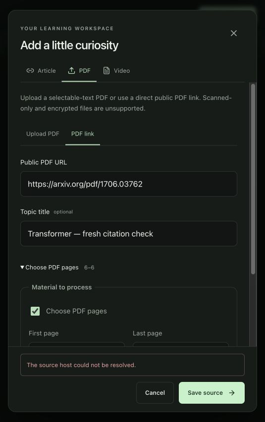

# Assistant baseline implementation and first sample — 2026-10-07

## What is implemented

Development-only authenticated collection and local DeepEval scoring live in
`backend/evaluation/`. A reviewed capture fingerprint is required. Collection uses
the production owned-context and post-generation revision checks, records actual
model retrieval context, and saves no invalidated answer. Incomplete/unreviewed
cases cannot silently count as passes. Raw reports are restricted to ignored
`output/evaluation/`; credentials stay in environment variables.

DeepEval 4.2.8 is an optional `eval` extra, locked and installed for this run in
`/tmp/secondbrain-eval-venv`. It is not imported by application routes. Telemetry
is disabled. Scoring uses explicit model/budget settings, no semantic release
thresholds, at most 12 judge calls, maximum 1,000 output tokens per call and
conservative pre-call token-cost reservations using SDK prices. SDK estimated
cost is not an invoice or a production per-answer ceiling.

## Regression evidence

- Backend: 206 passed using `backend/.venv/bin/python -m pytest backend/tests -q`.
- Web: 68 passed using `npm run test` in `web/`. Typecheck, lint and production
  build pass; Vite retains its existing bundle-size warning.
- New cases cover uncited physical PDF page retrieval, strict canonical-context
  correction/rejection, independent-source overview correction/rejection, exact
  excerpts in long-note synthesis, and evaluation stale-context exclusion.
- The new uncited-PDF case was replayed against the original `HEAD` generator: it
  failed by returning the feed-forward excerpt. Restoring the fix made it pass.
- The documented `uv run ... pytest` command selected global Anaconda's pytest
  and failed collection. `uv run ... python` selects project Python; use module
  invocation for reproducible backend checks in this environment.

## Fresh live sample

Dedicated anonymous acceptance library; source
`2dfc7546-802f-47a2-9b52-79577a48cb79`. Public
[Transformer paper](https://arxiv.org/pdf/1706.03762), physical page 6 only.
Authenticated PDF import and study acceptance succeeded. Only that named study
job was processed through existing lease/version fences; no dispatcher started.

Question: why the Transformer uses positional encodings. The manually reviewed
capture explains sequence order without recurrence/convolution. The answer
returned supported with valid exact page locations and matched the reviewed span
in retrieval context. Generation plus revision validation took 5.62 seconds.
This is a complete non-streaming answer, not first verified streamed text.

| Metric | Observed score |
| --- | --- |
| Exact reviewed-span retrieval hit | 1.0 |
| DeepEval contextual recall | 1.0 |
| DeepEval contextual precision | 1.0 |
| DeepEval faithfulness | 0.8571 |

Development judge: `gpt-4o-mini`, LLM mode, eight calls, $1 conservative budget.
SDK estimated judge cost: $0.0017205; conservative reserved cost: $0.0102762.
Generation usage/cost is unavailable and explicitly null, not zero. No model
winner, latency percentile, semantic release gate or production cost ceiling is
selected from one sample.

**Manual judge disagreement:** faithfulness's reason says the output implies
recurrence/convolution. The saved output explicitly says there is none. Treat
this verdict as a suspected judge error requiring review, not an app defect or a
perfect-grounding claim. One small-model judgment cannot calibrate the checker.

## Browser check and remaining scope

Retry connection restored the existing browser library. A separate fresh UI PDF
import of page 6 failed with a download error, then a bounded retry reported
that the source host could not be resolved, although the
acceptance-library API import succeeded. No note was created by this UI attempt.
This is a recorded blocker, not successful browser PDF acceptance.

Remaining: complete the 12 seed cases with reviewed fresh article/video and
cross-source/follow-up evidence, broaden live/model comparison, inspect successful
mapping/overview and browser locators/graph labels. #24 and #25 remain open.
Qdrant is approved as the next shared index target; no shared index yet.
