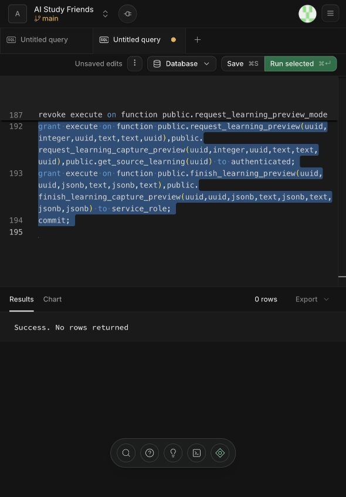
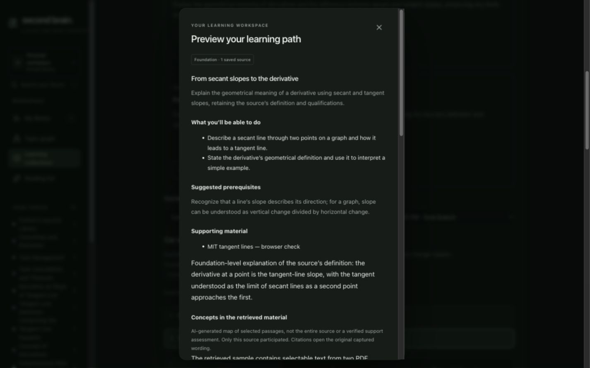
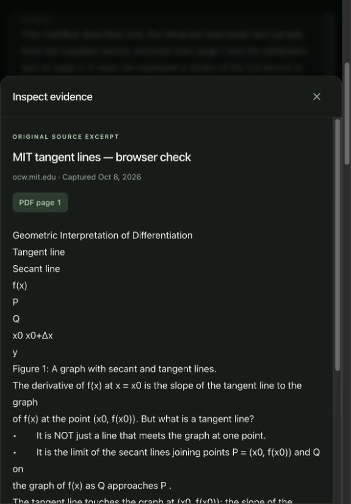
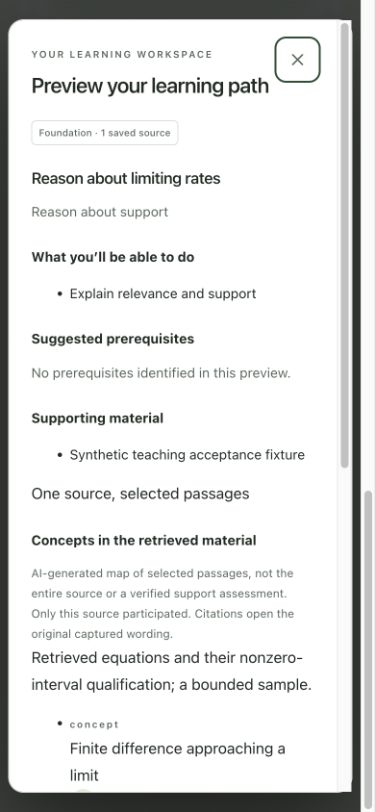
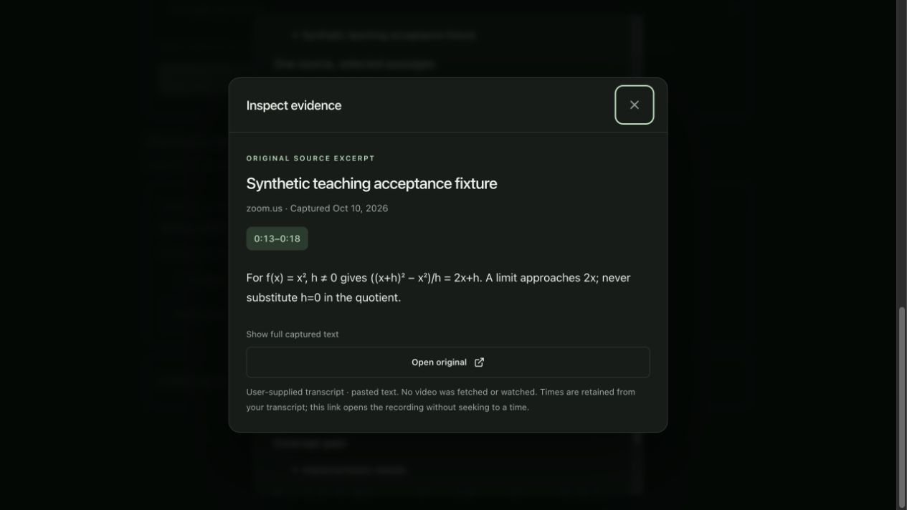

# U3a2 full-capture learning preview acceptance

Date: 2026-10-10, Asia/Singapore. Delivery [#36](https://github.com/CloudKai/secondBrain/issues/36),
part of [#29](https://github.com/CloudKai/secondBrain/issues/29).
Contract: [full-capture preview](../planning/full-capture-learning-preview-contract.md).
Reviewed base: `59e2cac` on `main`, plus the scoped implementation patch. Older
tracked and untracked work remains separate; this report does not accept that work.

## Implemented and checked in development

New source-based path previews offer **Full captured source** and **Saved note
passages**. Capture mode searches one owned, ready source with existing BM25 and
semantic retrieval, then gives the selected original passages to the learning
generator. It can teach details omitted from the saved note. This is a bounded,
goal-aware sample, not an exhaustive reading of a collection or source.

New immutable plans retain a versioned concept/coverage manifest, source version,
capture hash and index generation. Concepts, prerequisites, source examples and
qualifications have exact source links; missing material is described in gaps.
Generated lesson examples remain explicitly labelled. Reference display numbers
are consistent across the new plan's manifest, lessons, practice and tutor, while
stored IDs, offsets and location metadata remain unchanged. Old plans retain their
existing citation labels and wording.

Selection is limited to 24 references, 16,000 excerpt characters and 35 seconds.
The complete model input, including instructions and structured schema, is capped
at 30,000 characters. Existing Luna-medium generation and one bounded Sol-medium
structural repair remain; missing evidence stops before generation. There is no
calibrated semantic support check or confidence-based router in this unit.

Migration **022 applied successfully** to AI Study Friends after explicit approval
for the dashboard's main Production branch. SQL editor content was verified to
match the reviewed file exactly before execution. The click timed out, but the
subsequent state explicitly reported **Success. No rows returned**; it was not
clicked again. Query: `54f1c915-6955-4d2f-a8c1-4e2909269acf`.

## Automated checks

| Boundary | Result |
| --- | --- |
| Authenticated capture API/provider HTTP | 17 cases pass: hidden article/PDF/caption evidence, missing indexes/hits, source/index changes, attribution repair, same-request replay, owner denial, escaped input bounds and reviewed fragment transport |
| Actual local Postgres public RPC/RLS | 5 cases pass: exact original spans, preserved notes, no activity from preview, strict JSON coordinate/page/time types, owner denial, index races, source-removal redaction and rollback compatibility |
| Browser client/render boundary | Strict optional teaching schema, unknown IDs rejected, explicit evidence mode, source-map labels and numbered citations retaining original callbacks |
| Workspace regression | 361 backend / 134 web tests pass |
| Isolated base plus scoped unit | 295 backend / 121 web tests pass |
| Web typecheck, lint and build | Pass in workspace and isolated tree |

Backend regression uses `backend/.venv/bin/python -m pytest backend/tests -q`.
The prescribed `uv run --project backend --extra dev pytest backend/tests -q`
still selects system pytest without `langchain_openai` and fails collection;
it is not reported as passing. Existing backend deprecation warnings remain.
The full workspace build reports a 724.44 kB JavaScript chunk warning; the isolated
unit builds at 480.96 kB. Neither is a measured performance result.

The new tests were developed through the already approved API/provider HTTP,
Postgres ownership/version and browser seams. Hidden evidence, strict coordinates,
caption types, client schema and numbering had observed red-to-green cycles.
Final PDF and recovery checks added coverage without production code changes.

## Independent review and teaching limits

Six author-written synthetic cases were independently reviewed before generation
changes: a conditional article claim, Unicode PDF formula, cancellation/resource
cleanup, missing figure, conflicting benchmarks and qualified hash complexity.
Frozen dataset SHA-256:
`23397b34790b1032df587ddc5f9b438602a62bd64d4a8de26a08f01597caf0c7`.
Case transport checks preserve exact source fragments; controlled responses do
not score the model's teaching quality. This is not an educator validation,
held-out benchmark, calibrated grade or support classifier.

Separate standards and spec reviews have no remaining actionable findings.
Their code review does not independently establish hosted or educational quality.

## Live and browser acceptance

Two unconfirmed previews were generated from the existing public MIT PDF. The
first manifest mixed a labelled generated example and an absence statement into
its cited entries. Instructions were tightened to reserve entries for information
in the source, put generated examples only in lessons, and put absence statements
in gaps. The second preview followed that separation in this sample: two lessons,
four source-backed manifest entries, explicit generated background and missing
numerical-example/diagram limitations. Prompt guidance cannot guarantee semantic
support on future sources; that remains a quality-evaluation gate.

Read-only hosted verification found both previews saved with Luna provenance and
three references covering physical PDF pages 1 and 2. Every excerpt equals its
original Unicode slice, fits its original physical page, and has a matching capture
hash/source version; every manifest reference is known. Both remain unconfirmed.
The current branch remains `c5102f68-6457-40f6-9e50-a84216159bf3`, lesson index 1,
selection revision 5, with two active paths. Preview IDs:
`75392381-db8f-4683-b599-63f3a5902d36` and
`33ed4cf8-122f-483b-932b-5fbb294529d1`.

The live concept link opens the exact original MIT wording at PDF page 1; Escape
returns focus to the original citation inside the preview. Display numbers 1 and 2
retain their `p0001`/`p0002` callbacks. The desktop live preview measured 1440×900
without horizontal overflow. Reload restores the original selected lesson, saved
tutor exchange and question draft. Activity remains **0 studied / 2 attempts /
2 checks needing review**. No source, note, existing plan, answer or conversation
was regenerated or deleted, and neither new preview was activated.

A temporary HTTP fixture used the real collection/learning UI without hosted
writes. It checked unready-index errors retaining the goal/choice, explicit
preview confirmation/reload with zero activity, PDF page-2 Unicode evidence,
video 0:13–0:18 evidence, nested Escape/focus return, dark desktop 1440×900 and
light narrow 390×844 without horizontal overflow. Zoom recording links explicitly
state when seeking is unavailable. These are controlled browser scenarios, not
live provider PDF/video quality measurements. Fixtures and temporary tabs were
removed; the user's original dark theme/default viewport and collection remain.

## Recovery and next targets

Recovery SQL revokes capture request/finish access while retaining readable
metadata, history, deletion redaction and old note-mode writers. Saved note
passages remains an explicit alternative. No rollback was applied to hosted data.

#36 stays open for **actual 200% browser zoom and screen-reader acceptance**.
Earlier accessibility/export gates remain open. This unit does not establish the
200-source workload, 10–15-second first-useful-response target, hosted spending
ceiling, calibrated grading or production readiness.

Next target: U3a3 outcome-specific full-capture evidence in multi-source revisions,
with a contribution preview and explicit evidence coverage; then U3b stable
outcomes/check identity and actionable practice. U4 map/discovery and U5 shared
AI policy/evaluation/operations remain target work. No push, mobile/iOS or TinyFish.
