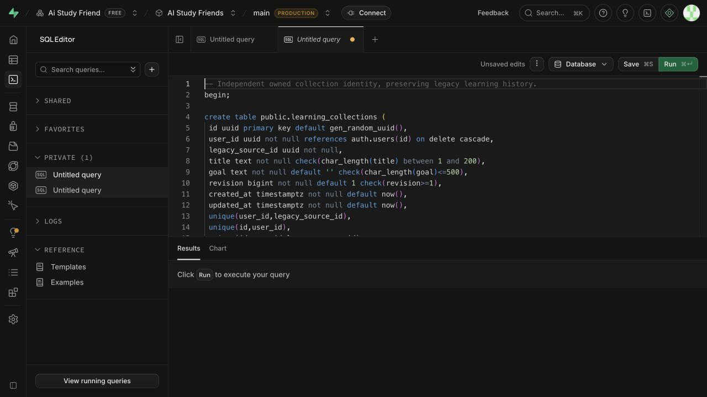

# U2a collection identity — local acceptance, 2026-10-09

## Status and reviewed state

Locally implemented and reviewed under [GitHub #31](https://github.com/CloudKai/secondBrain/issues/31), part of [#29](https://github.com/CloudKai/secondBrain/issues/29). Migration 019 is prepared in the AI Study Friends SQL editor, **not applied**. The dashboard labels the branch main Production; explicit approval is needed before applying the reviewed migration. Hosted backfill and authenticated live API checks remain open. No new learning workspace is claimed in this slice.

Reviewed baseline: commit `1835298305d50f6a9042a1ef9b7c4a56c8ca242e` plus the pre-existing working tree saved before U2a at `/private/tmp/secondbrain-u2-before.patch`. Review compared U2a against that saved state. Substantial earlier changes remain local. Mobile/iOS and model/retrieval behavior are unchanged by this unit.

## Implemented boundary

- Owned collection UUID independent of the removable original capture; the old source UUID remains a compatibility alias.
- Owner-bound, distinct source membership from the original saved source and confirmed plan manifests. Pending contribution previews do not expand coverage.
- Repeatable legacy-root backfill including removed anchors, branches, difficulty variants and pending-only roots. Plans, paths, attempts and exact evidence keep their IDs and wording.
- Saved cursor revision/timestamp survive attachment. The metadata trigger is temporarily suspended within the migration transaction and locked table, then restored; no historical selection event is fabricated.
- Existing path/confirmation/selection writers attach the new identity. Confirmed branch goals do not overwrite an established collection goal.
- Authenticated collection list/detail, old-source alias resolution and expected-revision selection API. Internal owner identifiers are validated and excluded from HTTP output.
- Owner RLS and composite ownership foreign keys. Learners cannot execute the privileged backfill or directly mutate membership.

API additions use `/api/v2`: `GET /learning/collections`, `GET /learning/collections/{id}`, `GET /sources/{id}/learning/collection` and `POST /learning/collections/{id}/plans/{plan_id}/place`. Selection shares the legacy cursor and requires `expected_revision`; stale writes return 409. Existing source routes remain available.

## Evidence and checks

| Check | Result |
| --- | --- |
| Backend full regression, existing project virtual environment | 299 passed; two existing warnings |
| Web full regression (`cd web && npm test`) | 106 passed |
| New Postgres public-RPC seams | 7 passed |
| Web typecheck, lint, production build | Passed; existing large-bundle warning |
| Whitespace | Passed |
| Hosted 019 / live collection reads | Pending approval/application |

The exact prescribed `uv run --project backend --extra dev pytest backend/tests -q` was attempted but selected the system pytest environment, which lacked `langchain_openai`; collection failed. The successful backend run used `backend/.venv/bin/python -m pytest backend/tests -q`. No dependency installation or configuration change was made to conceal this runner limitation.

The SQL seams cover repeatability, immutable snapshots/citations/cursor metadata, direct cross-owner RLS reads, legacy writer compatibility, removed-anchor history, confirmed membership deduplication, pending previews, shared stale-tab cursor, recovery and transactional abort on unmapped legacy data. HTTP tests cover authenticated ownership, malformed RPC responses, aliases, pagination and checked selection. No live source deletion, import, generation or feedback request was performed in U2a.

## Separate code reviews

- **Spec:** one recovery finding fixed. Collection list/detail/alias reads remain available during recovery; only the new selection API is disabled. Final review: no remaining actionable findings.
- **Standards:** one missing direct membership RLS regression fixed. Both collection tables are checked through learner roles. Final review: no remaining actionable findings.

Reviews were read-only, performed independently against the pre-U2a baseline. Tests were run by the implementation agent after the fixes.

## Recovery and limits

Migration aborts atomically if any path, place, plan, attempt or activity ownership mapping is incomplete. Backfill is repeatable; migration DDL is a one-time change. Stop and inspect a reported mapping failure instead of changing historical identity to force completion.

Recovery disables future collection workspace navigation/selection, retaining list/detail/history reads, aliases, identities, membership and legacy writers. Restore the checked selection grant for forward recovery. Do not drop the learning tables or reset IDs. Removing a source clears its captured evidence through existing behavior while keeping accessible learner history.

Current adapters preserve existing bounds: up to 50 list entries per page, 200 member summaries per detail, and existing snapshot limits for plans and history. This is not a 200-source performance claim. Collections without a source are retained legacy histories; new topic-only collection creation is a later workspace concern.

**Next target:** U2b focused collection workspace/navigation, then U2c durable drafts and tutor conversation. U3 full-capture teaching and stable outcomes, U4 broader map/discovery and U5 policy/operations remain target work. Actual 200% zoom, screen-reader and exact viewport acceptance from U1 remain open under #30 and must also be checked when the new workspace exists.

## Prepared migration

