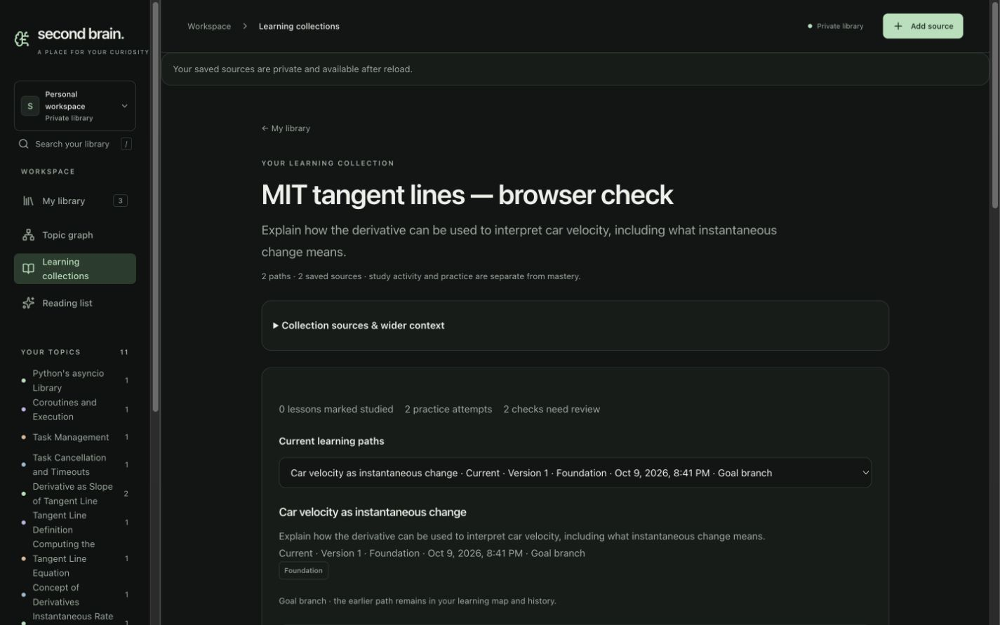
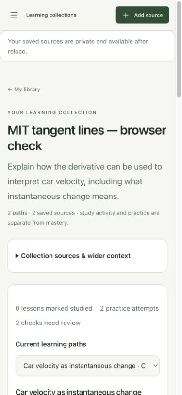
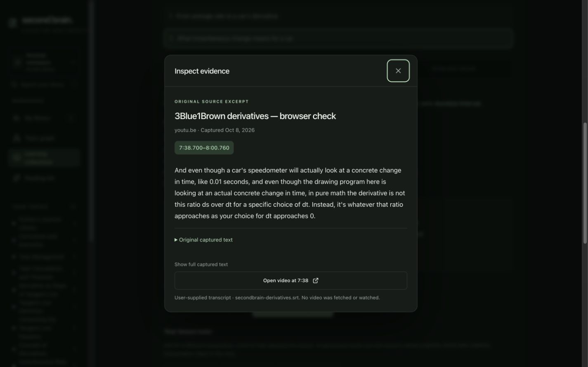
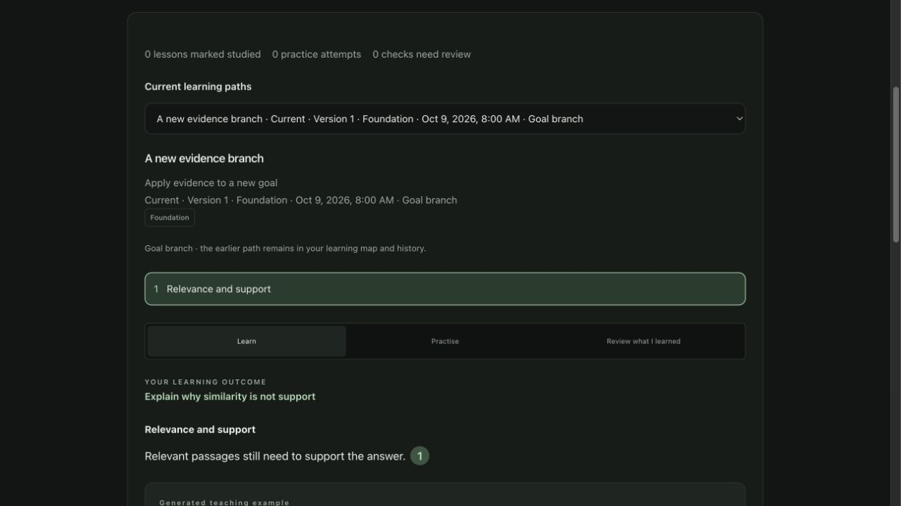

# Collection workspace — development acceptance

Date: 2026-10-09. Delivery: [#32](https://github.com/CloudKai/secondBrain/issues/32), part of #29, after completed identity/backfill #31. Reviewed starting commit `deb0bff` plus substantial pre-existing working changes. U2b diff was pinned against saved pre-unit frontend files; unrelated backend, indexing, import and assistant work remains separate.

## Implemented behavior

- `#collection/<owned-id>` restores the selected path and lesson. `#collection` lists owned collections with the persisted resume action.
- Library resume, source-note learning entry and topic learning buttons resolve the legacy source alias to the independent collection. Notes retain their existing routes. Before any path is confirmed, the first source preview stays usable inline.
- Goal, current path, Learn/Practise/Review, evidence, tutor and existing answers form the main workspace. Sources, plan coverage/gaps, map, dated previous versions, source contributions, difficulty and goal changes use secondary disclosures.
- Collection membership is distinct from the selected sources used to generate a plan. Removed anchors retain a destination for goals and saved answers; no substitute capture or missing citation is invented.
- Strict adapters validate owned identity, source/path counts, aliases, selection revision and list pagination. Unknown collections offer retry and Library return; missing initial learning roots are distinguished from authentication or service failures.
- Parent metadata refreshes after learning mutations without remounting the unchanged lesson workspace. Supplied snapshots avoid a duplicate child read that could overwrite newer cursor state.

The commit includes necessary existing U1 frontend continuity/version adapters and shared evidence reading components absent from HEAD. Isolated packaging caught and corrected two omitted topic-exploration state updates before commit. No API, database, model or retrieval changes in U2b. Migration 019 remains the compatibility contract. Durable unfinished answers and tutor conversation are **U2c target work**, not implemented here.

## Automated checks

| Check | Result |
| --- | --- |
| Targeted collection API/render tests | 7 passed |
| Full web suite in existing workspace | 113 passed |
| Isolated HEAD + selected commit files | 100 web tests, typecheck/build and lint passed; unrelated WIP excluded |
| Web typecheck/build | Passed; existing >500 kB bundle warning |
| Web lint | Passed |
| Backend regression via existing virtual environment | 299 passed, two dependency deprecation warnings |
| Exact prescribed `uv run --project backend --extra dev pytest backend/tests -q` | Failed before tests: resolves Anaconda/system pytest without `langchain_openai`; recorded successful command is `backend/.venv/bin/python -m pytest backend/tests -q` |
| Spec review | Metadata-refresh P2 fixed; no remaining actionable findings |
| Standards review | Duplicate initial-read P2 fixed; no remaining actionable findings |

Tests cover authenticated identity/pagination reads, unstarted aliases versus 401/503, checked selection revisions/unrelated responses, collection links for removed anchors, membership-versus-plan coverage, and retained dated versions/answers without missing citation controls. Existing Postgres seams verify source removal, immutable history, owner fences and navigation without awarded activity.

## Browser evidence

Against the existing development library, without generating notes or submitting practice:

1. Library Continue, original PDF note entry, direct link and reload reach collection `79b63966-af12-42fb-9574-657c3b0a997b`, car-velocity branch and saved lesson two.
2. Two current paths have dates, levels and version labels. The previous starting plan appears in a separate history disclosure; opening it does not activate a plan.
3. Practise shows the earlier learner answer and provisional Needs review feedback. Reading/mode/citation navigation left Library counts at **1 studied lesson / 3 attempts / 3 checks needing review** and collection counts at **0 / 2 / 2**.
4. Keyboard Enter opens passage p0010 from the original video at **7:38.700–8:00.760**. The seek link preserves `t=458`; Escape closes the dialog and returns focus to the originating citation.
5. Unknown collection ID produces a retryable unavailable state and no unrelated source/topic; Library remains accessible.
6. Measured viewport **1440×900** and **390×844** fit without document horizontal overflow in dark and light appearances. Temporary viewport override was reset and the original dark appearance restored.
7. A temporary isolated browser harness rendered the real CollectionWorkspace and SourceClient with fixture HTTP responses. One initial collection read confirmed the duplicate request was removed. Confirming a fixture goal branch caused exactly one refresh: goal changed, path count grew from one to two, new branch selected, without page reload. No live database or model mutation. Harness and temporary tab were removed.

Additional captures in the same folder show narrow dark, desktop light, saved practice and unavailable collection.

## Evidence limitations and open gates

- Keyboard semantics, labelled regions and native dialog behavior were inspected. A real screen-reader session remains unverified.
- Browser zoom shortcuts produced no measurable change (1440×900, DPR 1 before/after). **Actual 200% browser zoom remains unverified**; responsive resizing is not claimed as zoom. #32 stays open for these acceptance gates.
- Removed-capture UI uses literal HTTP/render fixtures and existing database removal seams. No live saved capture was deleted for this unit.
- Hosted UI deployment, 200-source capacity, educational calibration, model comparison/cost ceiling and 10–15-second first-useful-response measurements remain separate roadmap gates.

## Compatibility and recovery

All existing plan, attempt, source-version, page/time and citation identities remain unchanged. The collection cursor uses migration 019's checked writer; existing source-based learning writers remain available. Restore primary navigation to legacy source routes if necessary, while retaining collection detail/history routes for bookmarks. Use migration 019 recovery to revoke only new checked selection; never drop owned identities or saved history. No migration needed in U2b.

## Next unit

U2c: persist unfinished answers and tutor conversations with collection/plan/lesson ownership and safe source-version behavior. Record the handoff before beginning. U3–U5 remain target work.
