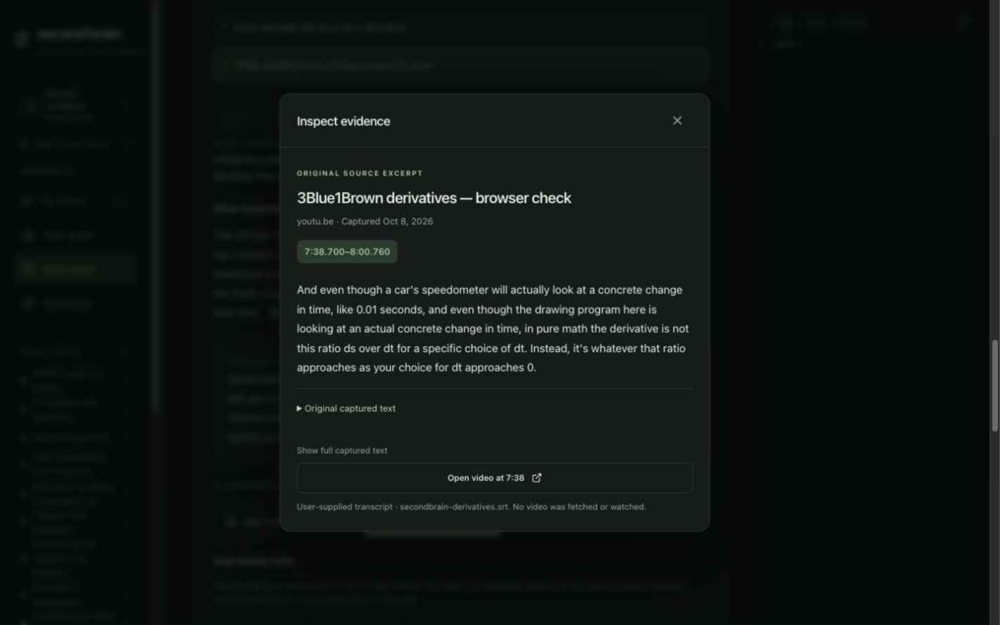
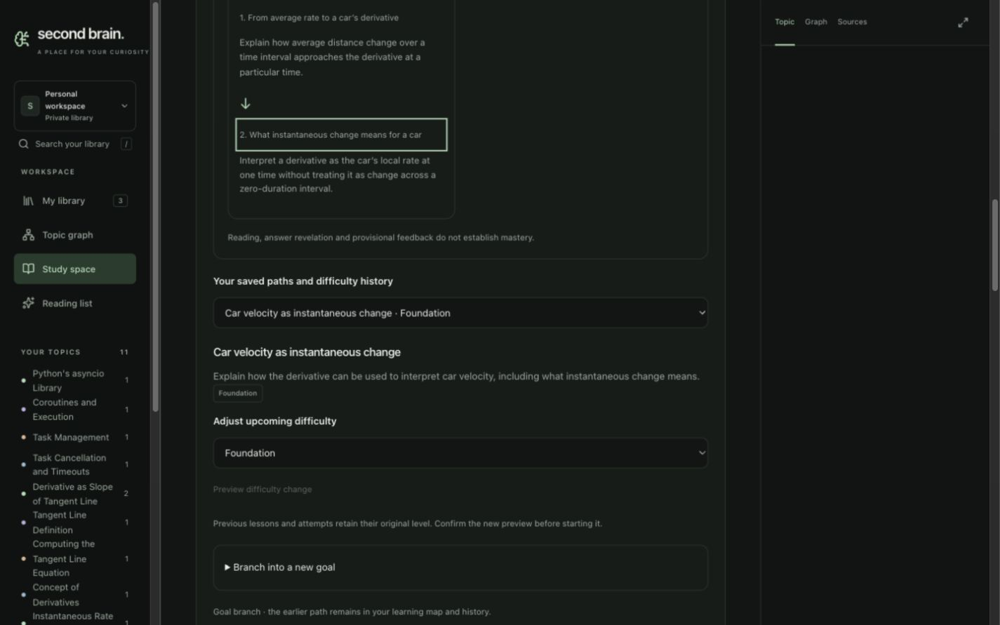
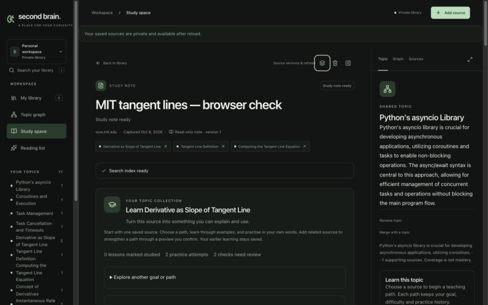
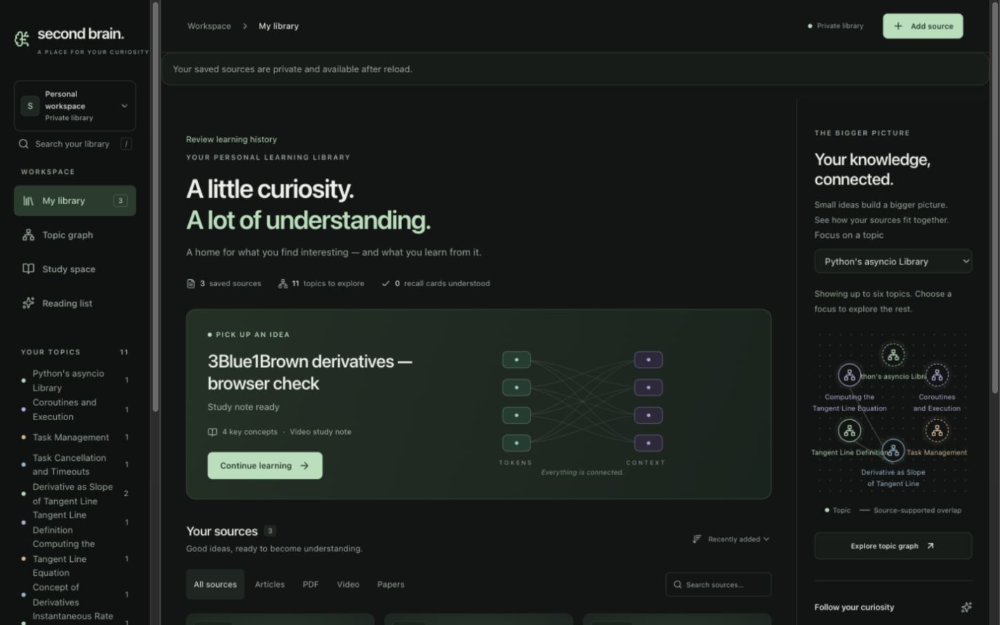
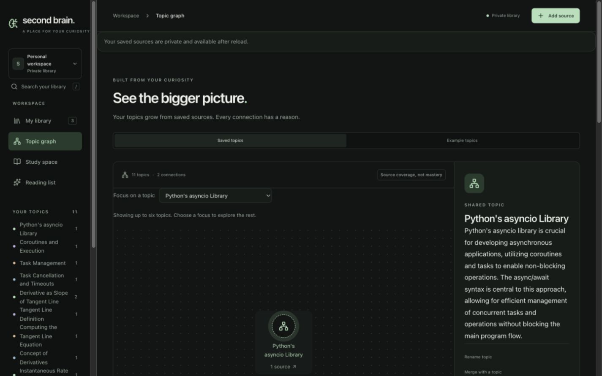
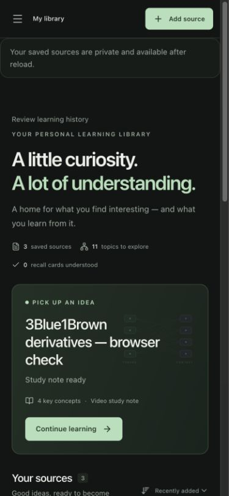

# Second Brain: audit against the ideal learning experience

Date: **2026-10-09, Asia/Singapore**  
Status: **Audit complete; improvements proposed, not implemented by this review.**  
Companion: [Ordered implementation roadmap](../planning/ideal-learning-app-roadmap-2026-10-09.md)

## 1. Product judgement

The product goal is to turn material a learner saves or discovers into a coherent, interactive learning journey that grows with their goals and reveals how concepts connect.

Second Brain has a credible foundation: owned source captures, inspectable citations, versioned learning plans, source-contribution previews, retained attempts and explicit learner choices. It already does more than summarize. However, the experience still asks the learner to navigate a source library and several separate learning surfaces. It does not yet consistently answer: **What am I learning, where did I stop, what should I try next, and how does this fit into my wider understanding?**

The largest improvement is a collection-centred learning home, followed by better evidence selection and practice feedback. Changing the model alone would leave the source-selection bottleneck, navigation ambiguity and disconnected progress intact. The existing source/evidence infrastructure should be retained.

## 2. Review snapshot and limits

| Item | Reviewed state |
| --- | --- |
| Repository | `CloudKai/secondBrain`, local branch `main` |
| HEAD | `1835298305d50f6a9042a1ef9b7c4a56c8ca242e` — Add retained goal branches and learning maps (#28) |
| Working tree | Dirty: 94 pre-existing short-status entries before audit assets; 95 including the new screenshot directory. Entries include modified tracked files and untracked directories, not 94 individual changed files. |
| Scope | Local web UI, backend learning/retrieval/generation code, SQL migrations, configuration names/templates and existing acceptance/evaluation reports |
| Live sample | Three saved sources: Python documentation article, MIT selectable-text calculus PDF, and a user-supplied derivative video transcript; 11 topics |
| Browser evidence | Desktop 1440×900 and narrow 390×844 screenshots; existing lesson evidence opened; Escape returned focus to the invoking citation |
| Exclusions | No new generation, grading, imports, deletions, migrations or provider benchmarks performed for this audit. Mobile unchanged. |

Findings describe the **working tree**, not just HEAD. Previously recorded test results establish earlier acceptance only. They were not rerun or promoted to fresh proof in this documentation task. The local environment file declares retrieval/indexing enabled; that alone does not prove the running process's effective environment or hosted readiness.

Severity: **High** materially disrupts the intended journey or blocks a dependable public release; **Medium** reduces clarity or maintainability; **Release gate** means the claim must remain unmade until measured. These are product priorities, not claims of an exploited security vulnerability.

## 3. What is good and should remain

1. **Evidence is inspectable.** The lesson citation opened the original transcript span at 7:38.700–8:00.760, showed its upload provenance and offered the original video location. Source formatting does not need to destroy original offsets. [Evidence dialog](../../web/src/components/EvidenceDialog.tsx), [reference validation](../../backend/sources/references.py).
2. **Changes are deliberate.** Adding a source, changing difficulty and branching a goal use previews and confirmation. Old plans and answers remain available. This respects a learner's changing intent. [Learning generation](../../backend/learning/generation.py), [learning store](../../backend/learning/store.py).
3. **Progress is treated cautiously in the new learning flow.** Study activity, attempts and provisional feedback are separate. New application questions do not inherit a previous passing result. [Shared learning context](../../web/src/components/SharedLearningContext.tsx).
4. **Ownership and freshness are architectural concerns.** Authenticated web routes, database ownership rules, source-version checks and worker fences provide a stronger base than client-only persistence. This is a code/acceptance observation, not a fresh penetration test. [Learning migrations](../../supabase/migrations/202610090017_learning_branches.sql).
5. **Retrieval infrastructure is already useful.** The derived Qdrant index combines BM25 and dense search and checks retrieved evidence against authoritative source/version data. It can be reused for teaching. [Hybrid retrieval](../../backend/retrieval/hybrid.py).
6. **Visual identity is coherent.** Charcoal/mint, source cards, evidence reading layout and clearly labelled generated examples give the app a recognizable character. Preserve these while simplifying hierarchy.

## 4. Findings

### F01 — Learning has no independent home · High

**Observed:** A collection-like learning flow is mounted inside a source note. The route remains `#note/<source-id>`, and the learning API is source-rooted. The original source identity is also used to group saved learning places. Retained history exists, including deleted-anchor handling; this is not a claim that history is currently erased.

**Evidence:** [App.tsx](../../web/src/App.tsx), `LearningJourney` placement; [learning.py](../../backend/learning/routes.py), source learning routes; migrations 015–017 and [LearningHistory](../../web/src/components/LearningHistory.tsx).

**Impact:** The learner has to remember which original document contains their ongoing journey. A source library is a weak home for a collection whose goal spans several documents.

**Improve:** Give an owned collection its own identity, destination and selected path/lesson. Sources become supporting members. Preserve source notes and their URLs.

**Acceptance:** A collection opens directly and from Library; removing its original source retains accessible learning history; existing plan and attempt IDs are unchanged. See U2.

### F02 — Current plans and older versions are hard to distinguish · High

**Observed:** The same title, “From secant lines to instantaneous change · Foundation,” appears twice in the saved-path selector. The open map renders both the one-source and two-source revision as parallel cards, without clear current/version/date labels. Map, source management, difficulty and branching controls precede the lesson.

**Evidence:** [LearningJourney.tsx](../../web/src/components/LearningJourney.tsx), `openedPlans` and selector at line 124; [LearningMap.tsx](../../web/src/components/LearningMap.tsx), all `data.plans` rendered in an initially open disclosure. Fresh DOM inspection confirmed identical option labels. Screenshot below records the surrounding management-heavy layout, rather than an opened native select menu.

**Impact:** Learners can continue an old revision unintentionally and must work through planning controls before learning.

**Improve:** Show one current revision per path; keep earlier versions in labelled history with dates, difficulty and change summaries. Put the current lesson first and planning controls in secondary panels.

**Acceptance:** Current and archived revisions are distinguishable visually and by accessible name; choosing history never silently changes the active plan; lesson access needs no traversal through a full map. See U1–U2.

### F03 — Directly reopened notes can show unrelated context · High, reproduced defect

**Observed:** Reloading the MIT calculus PDF shows “Python's asyncio Library” in the right-hand Topic panel. The main note and selected car-velocity lesson are calculus content.

**Evidence:** Screenshot below; [App.tsx](../../web/src/App.tsx), `selectedTopic` initialization at line 114, global fallback at line 207, and `openNote` context-setting path. Direct hash restoration can bypass the action that sets source-related context.

**Impact:** The interface implies a connection unsupported by the current source. It also weakens trust in the topic graph.

**Improve:** Resolve context from the current source/collection and its valid topic assignments. An intentionally explored unrelated topic must be clearly presented as separate exploration.

**Acceptance:** Direct links, reload, back/forward and evidence return restore the correct topic or an explicit empty context; no first-topic fallback masquerades as note context. See U1.

### F04 — Library resume and progress do not represent the learning journey · High

**Observed:** After inspecting the PDF's selected branch lesson, Library offers the most recently added video as “Continue learning.” It reports “0 recall cards understood,” while the learning collection displays two saved attempts and two checks needing review. These are different metrics, not necessarily contradictory counts, but the interface does not explain that distinction.

**Evidence:** [App.tsx](../../web/src/App.tsx), `currentNote` around line 192 falls back to `notes[0]`; library metric at line 1029 uses `mastered.length`; hero around lines 1033–1053 uses `currentNote`. New learning activity is persisted separately.

**Impact:** Returning learners can lose their place and interpret a session recall counter as overall learning progress.

**Improve:** Resume the owned last selected collection/path/lesson. Use consistent persisted study/attempt/feedback summaries and remove unsupported “understood” claims from aggregate activity.

**Acceptance:** Reopening Library offers the actual learning cursor; visiting a route or citation does not award progress; source counts, self-report and assessed activity remain separately labelled. See U1.

### F05 — Unfinished answers and conversations are temporary · High

**Observed:** Submitted attempts are saved, and the selected plan/lesson can restore. Unsubmitted answers live in component state. Lesson tutor messages and input also live in component state; the UI says conversation stays in the current view. Saved-evidence chat separately says it clears on reopening/refresh.

**Evidence:** [LearningJourney.tsx](../../web/src/components/LearningJourney.tsx), `responses` at line 23; [LearningTutor.tsx](../../web/src/components/LearningTutor.tsx), state at line 8; [SavedAssistant.tsx](../../web/src/components/SavedAssistant.tsx).

**Impact:** Evidence inspection across routes, a refresh or returning later can interrupt a learner's reasoning. Retaining submitted answers does not solve unfinished-work continuity.

**Improve:** Persist owned drafts and conversations with explicit lesson/version/scope identity and conflict handling.

**Acceptance:** An unfinished answer survives reopening without becoming an attempt; a transcript reopens in its original scope; source changes visibly invalidate evidence without deleting the learner's words. See U2.

### F06 — Lessons cannot use important evidence omitted from the note · High

**Observed:** Initial lesson generation selects from `context.note.references`, up to 30,000 excerpt characters. Revisions round-robin `item.note.references`, bounded by 100 references and a roughly 30,000-character serialized request. This fairly bounds work but never retrieves uncited parts of the captured source. Tutor and feedback use a further subset of the selected lesson's references.

**Evidence:** [learning_generation.py](../../backend/learning/generation.py), `preview`, `revision`, `feedback` and `tutor`. In contrast, [hybrid_retrieval.py](../../backend/retrieval/hybrid.py) searches indexed captures.

**Impact:** Useful examples, caveats or prerequisites missing from the summary cannot reach teaching, even when saved. This directly limits “learn as much as possible from one document.”

**Improve:** Build a source concept/coverage map and retrieve evidence for each goal/outcome from the captured material. Keep exact passage coordinates and disclose capture limitations and the plan's participating sources.

**Acceptance:** A supported detail deliberately omitted from a note appears in a relevant lesson with a correct original citation; missing material produces a gap, not invented support. Initially retain the existing maximum of eight supporting sources per generated plan. See U3.

### F07 — Practice exists, but adaptation and outcome identity are shallow · High

**Observed:** Each path has one to four lessons; each lesson has an outcome string, an explanation, optional example and one explain/apply/quick-question check. Feedback records criterion observations and an actionable hint, but stays provisional. Shared prior learning relies on exact outcome wording, matching difficulty and original evidence. There is no stable outcome identity or demonstrated adaptive next-action policy.

**Evidence:** [learning_models.py](../../backend/learning/models.py), `PathDraft`, `LearningLesson`, `UnderstandingCheck`; [SharedLearningContext.tsx](../../web/src/components/SharedLearningContext.tsx), exact matching at line 22.

**Impact:** Paraphrased revisions fragment learning history. A learner can receive feedback yet still need to decide unaided whether to retry, revisit a prerequisite or continue.

**Improve:** Stable outcome identities, separately versioned questions/criteria, and a small set of feedback-driven next actions. Preserve learner choice and difficulty history. More question types are useful only when their feedback can be evaluated.

**Acceptance:** Equivalent outcome history survives an explicit mapping across revisions; harder applications remain new checks; feedback identifies a specific next action; no model response or navigation event automatically establishes mastery. See U3.

### F08 — Two conversations offer different promises and behavior · High

**Observed:** “Your lesson tutor” generates explanations using Luna/Sol and lesson evidence. “A little help connecting the dots” uses a separate model and ultimately displays original source wording. The saved-evidence generator deliberately replaces drafted claims because semantic support is not calibrated.

**Evidence:** [LearningTutor.tsx](../../web/src/components/LearningTutor.tsx), [SavedAssistant.tsx](../../web/src/components/SavedAssistant.tsx), [assistant_generation.py](../../backend/assistant/generation.py), replacement at lines 163–166 onward.

**Impact:** Similar questions yield different styles and scope depending on the box. The exact-excerpt fallback is a useful safety property, but users need a consistent explanation of what they are receiving.

**Improve:** One tutor entry with explicit lesson, collection and library scopes. Keep backend policies appropriate to the task, and distinguish generated explanations, provisional feedback and original excerpts.

**Acceptance:** Scope is visible before sending and preserved in history; unsupported explanations yield useful excerpts or a gap; changing scope never silently includes unowned or stale evidence. See U2 and U5.

### F09 — The graph is a small neighborhood, not a growing subject overview · High

**Observed:** The live library has 11 topics. The graph presents up to six in a radial arrangement, filling unused places with other topics. The compact view can place Python and calculus nodes together without explaining their grouping. Group strings exist in the topic model, but are not a navigable subject hierarchy.

**Evidence:** [Graph.tsx](../../web/src/components/Graph.tsx), `visibleIds` and filler loop around lines 56–69; [topic_models.py](../../backend/topics/models.py). Screenshot shows the broader topic screen.

**Impact:** The learner cannot readily see “my calculus work within mathematics” or inspect a growing field. Visually adjacent nodes may feel related even without an edge. Similar derivative labels deserve review, but this audit does not establish that they are all duplicates.

**Improve:** Separate the chosen learning sequence from an evidence-based topic map. Add overlapping subject groups, topic search, focus/expand controls, clear relationship explanations and an accessible list alternative. Suggestions need a textual state and preview, not opacity alone.

**Acceptance:** The map explains the current focus and broader grouping without unrelated filler; suggestions are distinct from established coverage; rejecting/merging topics preserves corrections. See U4.

### F10 — Discovery is only loosely connected to learning gaps · Medium

**Observed:** Discovery receives a topic/goal query. Result relevance text is generic: found by web search, inspect the original. Readability and metadata checks are useful but are not a review of research quality or proof that a resource addresses a particular outcome.

**Evidence:** [ResearchDiscovery.tsx](../../web/src/components/ResearchDiscovery.tsx), [research_provider.py](../../backend/research/provider.py), generic relevance at line 189; learning discovery callback in [LearningJourney.tsx](../../web/src/components/LearningJourney.tsx).

**Impact:** Learners still perform the hard work of deciding what the resource adds and where it belongs.

**Improve:** Start discovery from a named coverage gap and collection goal. Explain prospective contribution, publication type, provenance and known limitations. Let saving choose a collection; keep incorporation into a path behind contribution preview.

**Acceptance:** A result explains its potential role without asserting unseen coverage; saving does not silently rewrite a goal or lesson; duplicate membership does not inflate evidence counts. See U4.

### F11 — Configuration and operational controls are not a single dependable contract · High before public release

**Observed:** Models and deadlines are spread across generators. `OPENAI_MODELS` appears in the local environment names but has no located code consumer; singular `OPENAI_MODEL` controls the legacy graph, not the learning tasks. `/health` reports static OK. The legacy `/api/v1/process-link` route has no visible authentication dependency. Vite supplies a development `/api` proxy; a built frontend needs an explicit production route.

**Evidence:** [learning_generation.py](../../backend/learning/generation.py), [graph.py](../../backend/core/graph.py), [main.py](../../backend/main.py), [vite.config.ts](../../web/vite.config.ts), environment templates and [compose.yaml](../../compose.yaml).

**Impact:** Developers may believe a setting changes all models, mistake liveness for readiness, or expose a generation endpoint without suitable controls. No exploitation or live hosted configuration was tested.

**Improve:** A versioned backend task-policy registry, validated capabilities at startup, safe readiness/worker diagnostics, consistent user quotas and spending reservations, explicit production routing and recovery runbooks. Some local limits already exist, such as learning-preview database restrictions; the gap is consistency, not total absence of controls.

**Acceptance:** Each generation task exposes its safe effective policy; missing configuration produces an actionable state; public generation endpoints are intentionally protected; budgets and failure recovery are tested. See U5.

### F12 — Anonymous ownership is not long-term account recovery · High before users depend on it

**Observed:** The web client persists an anonymous Supabase session and signs in anonymously. The session information explains that clearing browser data loses access; a linked-account recovery journey is not present in the reviewed UI.

**Evidence:** [source-client.ts](../../web/src/lib/source-client.ts), lines 183 and 200; session UI in [App.tsx](../../web/src/App.tsx). Supabase documents that anonymous users cannot regain access after losing the session unless an identity is linked: [anonymous sign-ins](https://supabase.com/docs/guides/auth/auth-anonymous).

**Impact:** A long-lived learning collection needs a dependable route back across devices or browser loss.

**Improve:** Specify optional account linking that preserves the owned user identity, plus a portable export of sources, provenance and learner work. Choose and validate the recovery method before public dependence.

**Acceptance:** Recovery restores the same collections and attempts; export distinguishes retained history from removed source evidence and does not resurrect deleted text. See U5.

### F13 — Documentation and release state have drifted · Medium

**Observed:** Root guidance and parts of context still describe the mobile-first baseline; newer web sections describe Supabase, Qdrant and learning. The local reviewed UI includes extensive uncommitted work. `App.tsx` is over 2,200 lines and coordinates route, note, topic and learning contexts, increasing the chance of restoration errors.

**Evidence:** [AGENTS.md](../../AGENTS.md), [project overview](../../context/project-overview.md), [learning design](../../context/learning-library-design.md), [web tracker](../../context/web-progress-tracker.md), Git snapshot above and [App.tsx](../../web/src/App.tsx).

**Impact:** A new contributor or deployment can reconstruct a different product from the one demonstrated locally.

**Improve:** A concise current web entry point, separate historical acceptance logs, a task/settings inventory and a reproducible release baseline. Extract route/domain controllers as the affected units are implemented, rather than scheduling an unrelated rewrite.

**Acceptance:** A clean checkout plus documented configuration reproduces the intended web behavior; active settings and rollout gates are clear; historical test counts are not presented as today's checks. See U1 and U5.

### F14 — Educational quality, accessibility and workload claims remain unmeasured · Release gate

**Observed:** Existing software acceptance covers substantial boundary behavior. It does not calibrate teaching effectiveness or grading correctness. Classifier development reports use small development samples: the Laya report records 17/20 with three false supports; the comparison report records MiniCheck 18/20 with two false rejects. Neither establishes a production winner. No complete teaching benchmark comparing Luna-only, Sol-only and routing is recorded.

**Evidence:** [Laya development report](laya-classifier-development-2026-10-08.md), [classifier development report](grounding-classifier-development-2026-10-08.md), [branch acceptance](learning-branches-acceptance-2026-10-09.md), [evaluation directory](../../backend/evaluation/).

**Impact:** Fast valid JSON and valid citation IDs do not prove a clear explanation, a supported claim or fair feedback on an unconventional valid answer.

**Improve:** Independently reviewed teaching/answer cases with held-out evaluation; pair model policies on the same evidence and questions. Use DeepEval as supporting analysis and inspect disagreements. Measure accessibility, latency, cost and capacity explicitly.

**Acceptance:** Report rubric results, serious failure examples, uncertainty, model/policy versions and measured costs. Complete keyboard, both themes, narrow/desktop, actual 200% zoom and screen-reader scenarios. Measure the 200-source workload and first useful response target; do not infer either from smaller samples. See all unit gates and U5.

## 5. Actual AI and deployment configuration

This table reports code configuration, not a guarantee of provider availability, price or running-process settings.

| Task | Current code policy | Practical limitation |
| --- | --- | --- |
| Learning preview, revision, feedback, tutor | `gpt-6-luna`, medium; one `gpt-6.1-sol`, medium fallback; `learning_v1`; 9,000 output-token cap; 100-second outer deadline, 65/35-second request timeouts | Escalation handles invalid structure/attribution, not calibrated semantic confidence. HTTP failures/timeouts do not automatically follow the same repair path. |
| Source notes, topic organization, overview | `gpt-4o-mini` defaults | Changing a global legacy setting does not select these policies. |
| Saved-evidence assistant | `gpt-4o-mini`; final answer rendered from exact attributed wording | No calibrated semantic verifier or verified answer streaming in the reviewed production path. |
| Research discovery | `gpt-4.1-mini` with web search, 2,000 output-token cap, bounded overall search | Search and readable links do not establish instructional or scientific quality. |
| Retrieval | `text-embedding-3-small`, 1,536 dimensions; Qdrant BM25 + dense; 40 candidates per branch, RRF to 24 | Scope/version checks matter as much as ranking. A configured 200-source inventory limit is not a load-test result. |
| Indexing | Structure-aware recursive chunks, 2,800-character bound, up to 200-character overlap | Derived index; original captures remain authoritative. |
| Web/API/workers | Vite development proxy; FastAPI; Supabase authoritative state; Qdrant derived index; local Redis transport configuration | Hosted proxy, worker supervision, recovery and release process need a complete operational acceptance record. |

Server-only credential boundaries are appropriate. No credentials are reproduced here. The plural unused environment setting should be removed or rejected with a clear warning in a later configuration unit; model selection should remain explicit per task as the user requested.

## 6. What the ideal journey should feel like

For the inspected calculus material: Library resumes **“Understand derivatives” → “Car velocity” → the unfinished lesson**, rather than choosing the newest source. The learner sees one outcome, an explanation, the cited evidence and one useful practice action. Their draft survives a return from a citation. Feedback suggests a specific retry or prerequisite without declaring mastery.

If an explanation needs a detail outside the note, teaching can retrieve it from the captured PDF or transcript. If the capture lacks it, the app names the gap and offers relevant discovery. A newly saved source shows what it could add before a confirmed revision changes the path. The map locates derivatives within an emerging mathematics grouping, while the learning path records the learner's chosen sequence. Prior versions and attempts remain inspectable.

This is **target behavior**. Parts already exist, but the full sequence is not yet implemented or verified.

## 7. Priority and evidence limitations

Execute [the roadmap](../planning/ideal-learning-app-roadmap-2026-10-09.md) in this order:

1. Repair context, resume, metrics and version labels (F02–F04).
2. Establish the collection workspace and durable unfinished work (F01, F02, F05, F08).
3. Improve evidence selection, stable outcomes and next practice actions (F06–F07).
4. Connect the broader map and gap-specific discovery (F09–F10).
5. Harden task policies, evaluation, recovery and deployment (F08, F11–F14).

Evaluation fixtures and baseline measurement should begin before changing teaching; public release gates apply throughout. The numbered order does not authorize public deployment before operational protection is complete.

The audit did not conduct a new full accessibility, security, load or educational-effectiveness study. The screenshots are a small local sample; fresh dark desktop/narrow inspection and evidence focus return are recorded, while earlier dark/light acceptance remains historical. Actual 200% zoom and screen-reader checks remain explicit future gates. Source images/diagrams absent from PDF extraction remain absent; “full captured evidence” must never imply full original-document comprehension.

Practice testing and distributed practice have support in the learning literature, which motivates useful voluntary retrieval and revisiting, not a claim that this app already improves retention: [Association for Psychological Science review](https://www.psychologicalscience.org/publications/journals/pspi/learning-techniques.html). Accessibility acceptance should use actual browser/text resizing and assistive technology, with [WCAG](https://www.w3.org/TR/WCAG22/) as the reference rather than treating narrow screenshots as an accessibility pass.
