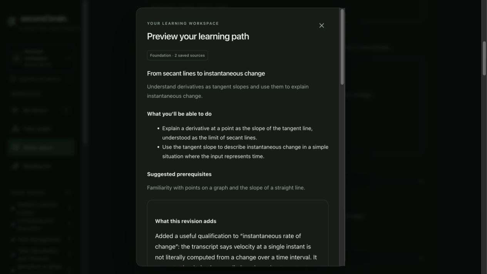

# Learning collections — development acceptance

Date: 2026-10-09. GitHub #28 remains open. Phase 2 extends commit 49a02c7;
branches/graph learning states are the next unit, not current capabilities.

## Implemented and checked

- Owned related-source candidates across any current collection member;
  source addition previews explain contributions, order and differing perspectives.
- Explicit confirmation changes the active plan; the goal and earlier answers stay.
  Difficulty previews retain every collection member and the intended direction.
- Immutable member/version/topic fingerprints fence preview, confirmation, practice
  and late feedback. Evidence aliases retain exact original identifiers/coordinates.
- Delete clears copied evidence, not learner responses. Archived inspection uses the
  existing owned version reader. Only current support permits new work.
- Migration 016 applied through the development Supabase SQL editor. Its success
  is recorded in assets/learning-collections/migration-016.png. No warning appeared.
- Live MIT tangent-line PDF + derivatives video: confirmed a foundation path,
  submitted an answer, obtained provisional criterion feedback, previewed the video
  contribution, inspected PDF page 1 and video 3:26.700–3:30.720, and confirmed the
  revised plan. Original notes remain separate and new checks receive no old pass.
- Keyboard Escape closes the nested evidence dialog and returns focus to its
  citation while keeping the plan preview open. Narrow dark/light appearances inspected. Reload restored the confirmed collection
  and opening prior history retained the original answer; revised checks had zero attempts.
- Two independent reviews (spec/standards) found candidate coverage, disagreement
  attribution, lock identity recheck and full input budget issues. All corrected
  with public boundary regression checks; subsequent reviews cleared blockers.

## Automated evidence

291 backend tests and 89 web tests pass. Web typecheck, lint and build pass.
Focused learning: 25 backend cases, 5 public SQL persistence cases. Fixtures cover
ownership, retry leases, exact PDF/video coordinates, source changes/removal,
A→B→C membership, retained attempts, unchanged goals/difficulty directions and
30,000-character serialized input bounds including Unicode/instructions.
Rollback is tested on real unused previews and refuses confirmed collection history;
exclusive locks protect its check. Export/migration is required to roll back used
collections. The prescribed uv command selected the wrong external pytest runtime;
checks used backend/.venv/bin/python -m pytest backend/tests -q instead.
Two existing backend deprecation warnings and the existing >500 kB web bundle
warning remain. git diff --check passes.

## Limits and remaining acceptance

Feedback is always provisional Needs review: exact citations and JSON validation
are not semantic grading. Held-out independent teaching/assessment evaluations,
explicit hosted cost ceiling, end-to-end latency, capacity, screen-reader and actual
desktop/200% zoom acceptance remain open. The IAB viewport remained narrow despite
prior viewport overrides. Supabase sometimes timed out; recovery restored saved
work. Docker/Redis recovered and the user-approved worker was restarted. Mobile
and iOS were untouched. No public production rollout or push claimed.

