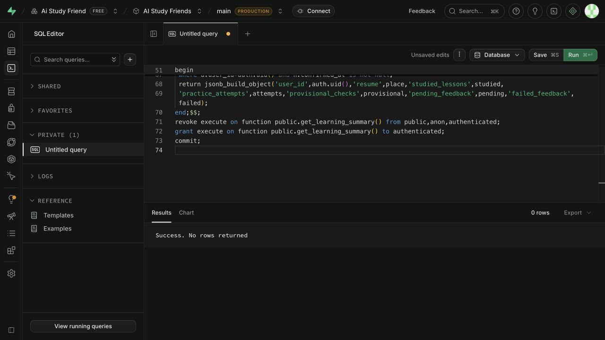
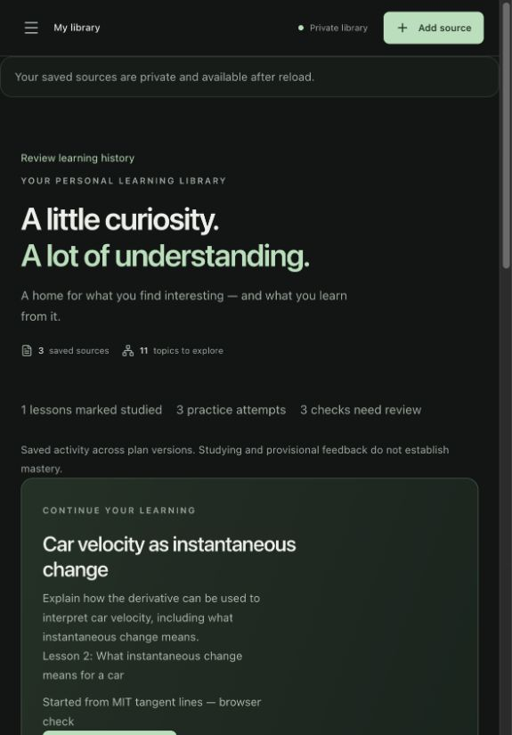
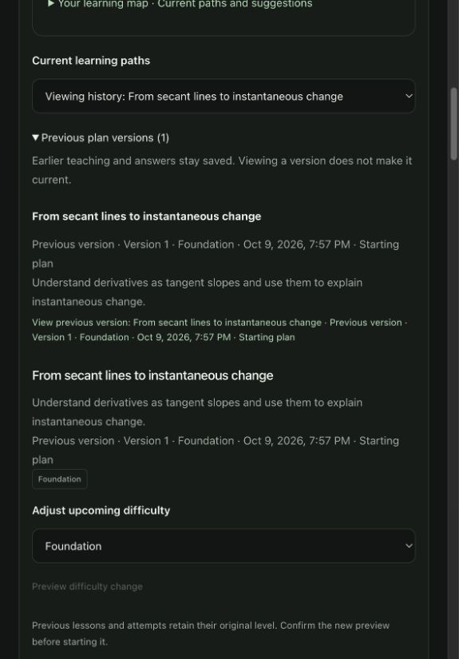
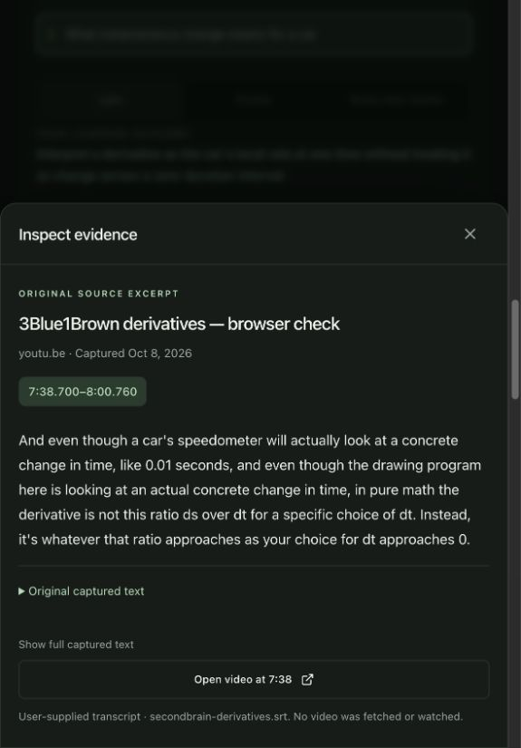
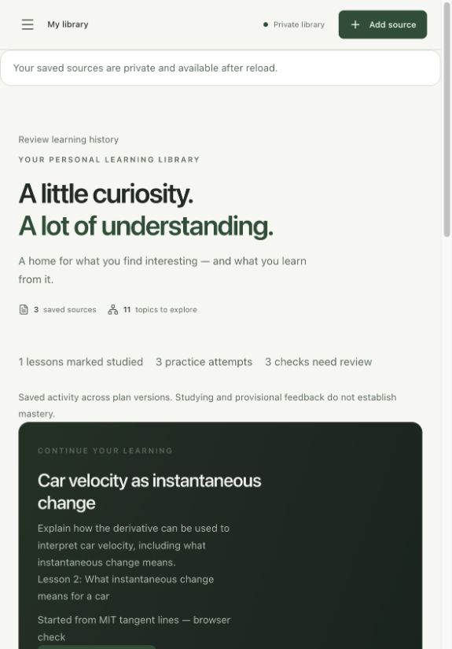

# U1 learning continuity — development acceptance

Date: **2026-10-09, Asia/Singapore**. Delivery: [GitHub #30](https://github.com/CloudKai/secondBrain/issues/30), part of [#29](https://github.com/CloudKai/secondBrain/issues/29).

Published progress: [U1 results](https://github.com/CloudKai/secondBrain/issues/30#issuecomment-6082539917) and [parent checkpoint](https://github.com/CloudKai/secondBrain/issues/29#issuecomment-6082541330).

**Implemented in development:** correct source context, persisted Library resume/activity, stale selection checks and distinct plan history. **Remaining acceptance:** a verified desktop/narrow viewport matrix, actual 200% browser zoom and a screen-reader session. This record does not establish public readiness or complete the five-unit specification.

## Baseline and scope

Reviewed HEAD: `1835298305d50f6a9042a1ef9b7c4a56c8ca242e` on `main`, plus the substantial pre-existing dirty working tree. Changes remain local; this unit has not committed or pushed the unrelated work. Mobile/iOS and its progress tracker are unchanged.

The original audit reproduced calculus notes displaying Python topic context, a newest-source resume action, session-only recall counters and indistinguishable revision labels. U1 repairs those behaviors. Independent collection identity, durable unfinished answers/conversations, full-capture lesson retrieval, stable outcomes, larger maps and shared AI policy remain **target work in U2–U5**.

## Implemented behavior

| Area | Development behavior |
| --- | --- |
| Note context | Source routes resolve a topic from the source's current assignments. Deliberate unrelated exploration is labelled separately; an unrelated global topic is not the default. |
| Resume | Library reads the owner's newest timestamped saved root/path/plan/lesson. The selected goal and lesson appear above the separate source-opening card. |
| Activity | Library aggregates explicit studied lessons, saved attempts and pending/provisional/failed feedback across confirmed plan versions. Opening a page, choosing a lesson and inspecting evidence award no learning activity or mastery. |
| Version history | The current selector shows current confirmed plans. Previous versions have version/date/difficulty/reason labels inside a history disclosure. Viewing history changes the saved place without activating that plan. Reactivation is an explicit action. |
| Save timing | When a save finishes after leaving a note, Library refreshes its summary. A failed or stale save reloads the authoritative selected lesson instead of silently retaining the unsuccessful optimistic selection. |
| Failure | Summary errors offer retry while keeping the source library available. Removed original sources lead to retained owned history. |

The summary uses one shared event vocabulary with source-level learning activity and graph summaries. Counts measure activity records across revisions, not unique mastered concepts. Feedback remains provisional and requires review.

## Migration and compatibility

The user explicitly approved migration **018** after automatic approval review flagged the dashboard's `main PRODUCTION` label. It was applied to the AI Study Friends project `rpcclvvcfsxlytosfhxt`. Supabase returned **Success. No rows returned.**

The additive migration adds selection timestamps/revisions, an authenticated owned summary and an expected-revision selection RPC. Existing plans, answers, sources and original citation coordinates are retained. Legacy places have an unknown timestamp; their order is not fabricated. Library asks the learner to choose a saved path until an explicit selection or confirmation records a timestamp. The previous selection RPC remains available for compatibility; old clients do not receive the new optimistic concurrency guarantee.

API additions are `GET /api/v2/learning/summary`, `selected_place_revision` on learning snapshots and optional `expected_revision` on lesson selection. New clients send it; stale writes return HTTP 409. Owner identifiers are validated internally and excluded from public responses. Summary reads neither mutate progress nor invoke models.

**Recovery:** revert the UI/API first, then use the matching 018 rollback. It restores the 017 read contract and revokes the added authenticated RPCs while retaining metadata and learner data. The rollback test preserves a saved answer and selected plan and verifies the previous writer still works. To restore forward behavior after rollback, reapply the wrapper and grants; do not rerun the already-applied additive DDL wholesale. Earlier destructive rollbacks are not a substitute for this recovery path.

## Automated checks

| Command / seam | Result |
| --- | --- |
| `backend/.venv/bin/python -m pytest backend/tests -q` from repository root | **296 passed**; two existing deprecation warnings. |
| `npm test` from `web/` | **99 passed**, no skipped tests. |
| `npm run lint` from `web/` | Passed. |
| `npm run build` from `web/` | TypeScript check and Vite build passed. Existing bundle warning remains: JavaScript approximately 681 kB before gzip. |
| Authenticated learning HTTP boundary | Owned summary, missing auth, unexpected owner and stale expected-revision conflict checked. |
| Real SQL public RPCs in PGlite | Persisted place/revision, stale rejection, navigation without progress, study/attempt aggregation, other-owner isolation, removed-source retained history and nondestructive rollback checked. |
| Public learning view rendering | Current map/version labels and Library selected plan/lesson/activity output checked. |

The exact repository `uv run --project backend --extra dev pytest backend/tests -q` command was attempted. Sandbox cache access first required escalation; the resulting invocation selected a system pytest/Python without the project's `langchain_openai` dependency. The existing project virtual environment passed the full suite. This is a runner/environment limitation, not a claim that the exact `uv` command passed.

## Live checks

Used existing saved public Python article, MIT PDF and user-supplied 3Blue1Brown transcript. No live source was imported/deleted, no new practice answer or study completion was awarded, and no teaching/feedback model request was made in this unit.

1. Opened the MIT PDF directly after the unrelated topic state. Learning resolved **Derivative as Slope of Tangent Line**; reload restored the selected car-velocity branch.
2. Selected lesson two, returned to Library and resumed the same branch/lesson. Library reload retained **What instantaneous change means for a car**, instead of choosing the newer video source.
3. Returned to Library while a selection was still saving. The initial check exposed a stale summary race; after the refresh fix, late completion updated Library correctly. Repeated with another lesson, then restored the learner's original branch and second lesson.
4. Opened previous version one of **From secant lines to instantaneous change**. It displayed a previous-version label and explicit **Make this the current version** button; the selector still labelled version two current. No reactivation was performed.
5. Opened lesson citation `p0010` from the supporting transcript. Evidence showed the exact source wording and **7:38.700–8:00.760**. Escape closed the dialog and returned focus to that citation button.
6. Library's **1 studied lesson / 3 practice attempts / 3 checks requiring review** remained unchanged through navigation, history selection, evidence and reload. The PDF root separately retained its **0 / 2 / 2** activity.
7. Checked the visible compact layout in both dark and light themes. Long goal, version labels and resume information wrap. Restored the original dark theme and saved second lesson, and reset temporary viewport overrides.

## Evidence limits and remaining gates

- The browser's viewport override accepted 1440×900 and 390×844 commands, but a subsequent DOM measurement still reported **590×846**. These screenshots establish the current compact panel, not those requested exact sizes. A separate verified desktop/narrow matrix remains pending.
- Native zoom shortcut did not change the measured viewport/scale. **Actual 200% browser zoom has not been verified.** Viewport resizing or CSS scaling is not counted as that check.
- Accessible labels, native accessibility-tree exposure, keyboard citation opening and Escape/focus return were inspected. **A real screen-reader session remains pending.**
- Removed-source recovery, stale tabs and rollback passed automated owned RPC checks; no live source was removed or live database rollback performed.
- No new live generation or grading quality was assessed. Held-out teaching quality, routed-model cost, latency, 200-source capacity and public operational protection remain existing rollout gates.

Keep #30 open for the remaining visual/accessibility acceptance. The next implementation unit is **U2: independent collection workspace**, delivered as migration/compatibility, workspace/navigation and durable drafts/chat subunits. It must preserve the U1 source context, saved selection, history and original citation behavior.
