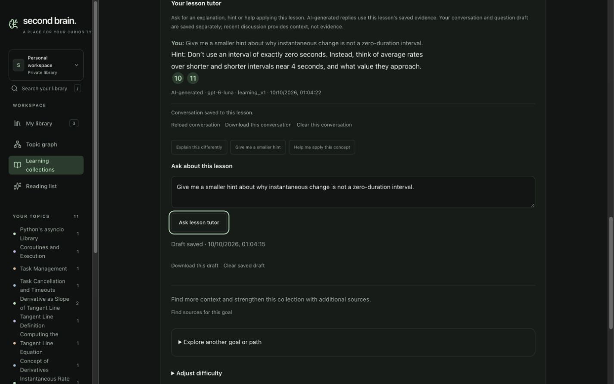
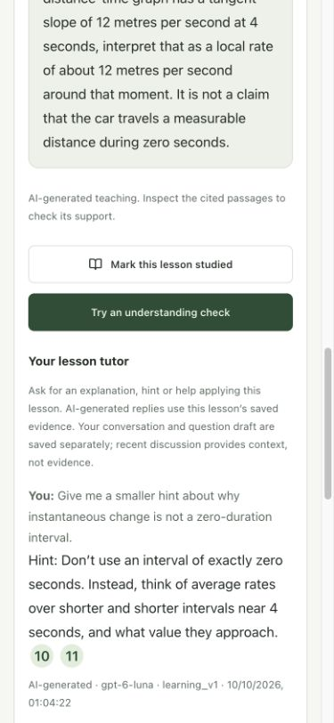
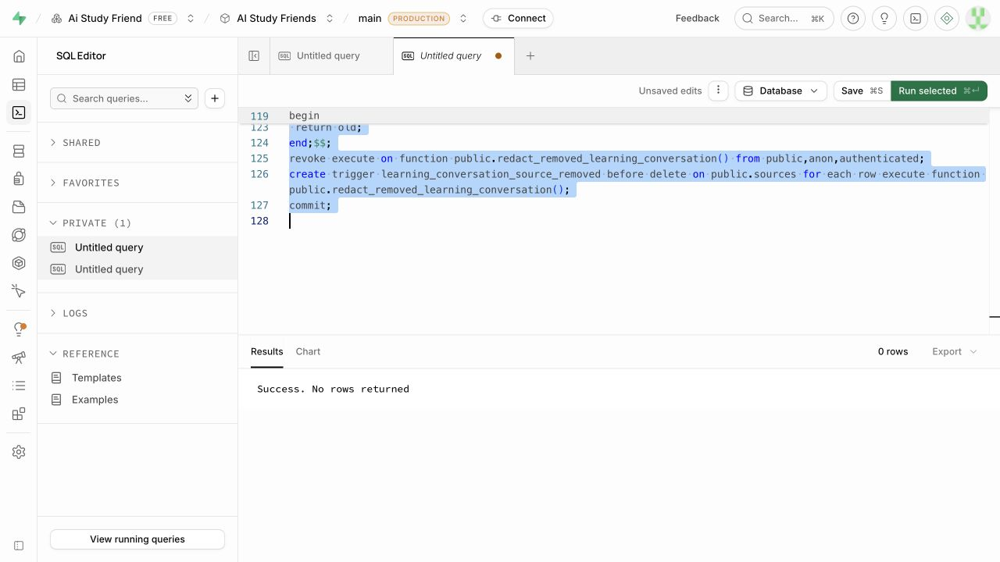

# U2c2 saved lesson conversations — development acceptance

Reviewed base: **11bb05b**, plus this unit's scoped diff. The starting working tree included substantial older AI/retrieval/presentation WIP; it was preserved and excluded from this unit. GitHub **#34**, part of **#29**. Contract: `docs/planning/learning-conversations-contract.md`.

## Implemented and verified

- Owned collection/immutable plan/lesson conversations, durable ordered exchanges, checked revisions, leased and idempotent sends, three-attempt retries, explicit failed/pending states, current-evidence completion fences and exact citation assignments.
- Server chooses two recent completed, unredacted exchanges as context, bounded to four 1,000-character messages. Client bodies cannot supply conversation history or ownership. Model provenance records the actual Luna/Sol result and learning_v1 policy. Generation policy is unchanged; structural repair is not proof of claim support.
- Sources removed from a plan redact generated replies/citations without removing learner questions or provenance. Reopening reads fresh state; exports fetch current authoritative history before producing a file. Versioned lesson JSON export and checked clear are separate from drafts, attempts and activity. Clear keeps request tombstones, fencing late replies/retries.
- Hourly new-request quota serializes across an owner’s collections; per-thread retained history is bounded. Rollback disables new generation while retaining reads, redaction and clearing.

## Evidence

| Boundary | Result |
| --- | --- |
| Postgres public RPC/RLS | Exact Unicode question/reply, reopen/retry, owner denial, invalid lesson, changed retry, concurrent-send busy fence, stale clear, clear during generation, failed-send retry ceiling, source-change finish rejection, removal redaction, hourly limit and recovery pass. Actual cross-connection quota concurrency is not load-tested; lock ordering was reviewed. |
| Authenticated API/provider HTTP | Strict owner/slot/state validation, context chosen from saved history, no client history/owner input, Luna default, Sol structural repair, provider failure and stale completion do not produce a completed reply. Immediate completed retry does not call the provider again. |
| Browser HTTP fixtures | Failed send → reload → same retry; lost response → reload resolves one saved exchange; separate lessons; re-entry after history was cleared elsewhere refreshes; initial session failure recovers through Reload; sign-out clears two pending lesson slots including one not reopened; removed-source history is redacted; fresh export contains null reply/redaction labels; keyboard clear/cancel preserves the separate question draft. |
| Hosted migration | **021 applied successfully** to AI Study Friends, project rpcclvvcfsxlytosfhxt, dashboard main Production. Editor text copied back exactly matches the reviewed file. No warning or automatic-approval rejection. SQL query: `163af5ed-34e1-4e3b-829b-ec602538740f`. |
| Live exchange | Existing PDF/video collection 79b63966-af12-42fb-9574-657c3b0a997b, goal-branch plan c5102f68-6457-40f6-9e50-a84216159bf3, lesson index 1. One public-calculus question produced a saved **gpt-6-luna / learning_v1** hint citing p0010/p0011. Full app reload restores the same exchange and question draft. No source regeneration/deletion or practice submission. |
| Citation/keyboard | The saved tutor's p0011 opens the original video passage at **8:17.740–8:30.140**. Enter opens it, Escape returns focus to that tutor citation. Tab reaches the ask control. Clear confirmation receives focus, cancel restores Clear, and completion restores Reload. |
| Ownership/activity | Live unauthenticated conversation read is **401**. Collection stays **0 studied, 2 practice attempts, 2 checks need review** after generation/reload/evidence navigation. |
| Presentation | Actual **1440×900** desktop (document1425) and **390×844** narrow (document375) fit without horizontal overflow in both themes. Original dark appearance and default viewport restored. |

**Workspace:** 124 web tests and 324 backend tests pass; web typecheck/lint/build pass. Existing Vite large-bundle warning remains. Prescribed `uv run --project backend --extra dev pytest backend/tests -q` still selects Anaconda/system pytest without langchain_openai and fails collection; successful backend run uses `backend/.venv/bin/python -m pytest backend/tests -q`.

**Isolated base + this unit:** 111 web tests and 258 backend tests pass; web typecheck/lint/build pass. No dependency on unrelated working-tree changes.

## Review and limits

### Standards

Initialization retry, stale reopening and owner-wide quota findings were corrected. Re-review: no remaining actionable standards or material cohesion findings. No hard ownership/API validation breaches found.

### Spec

Reopening and pending cleanup for unopened slots were corrected. Re-review: no remaining actionable spec findings. The browser also exposed lost focus after inline clear/cancel; focus handling was corrected and checked.

Review summary: **0 remaining Standards findings; 0 remaining Spec findings.** No remaining worst issue in either axis.

Actual **200% browser zoom**, a real **screen-reader run**, and **native file-download completion** remain unverified; the browser's actual Blob payload is verified. #34 remains open for these gates. One live tutor reply does not establish educational accuracy, cost calibration or latency at the 200-source workload. Those remain U3–U5 targets. Collection/library tutor scopes remain U5; legacy source-only tutor callers remain compatible and view-local.

API restarted with its existing ignored environment file on 8000, exec session 32781. Approved worker/Vite retained. Temporary fixtures and agent-created tabs removed; learner collection remains open. Mobile/iOS unchanged; no push.

## Screenshots

