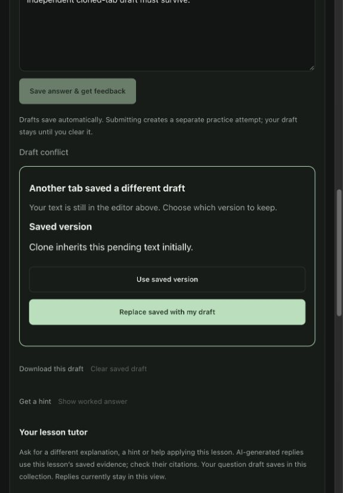
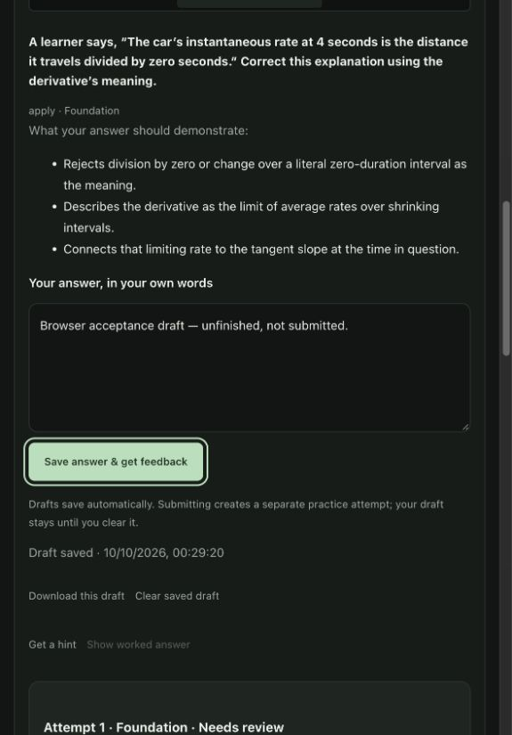
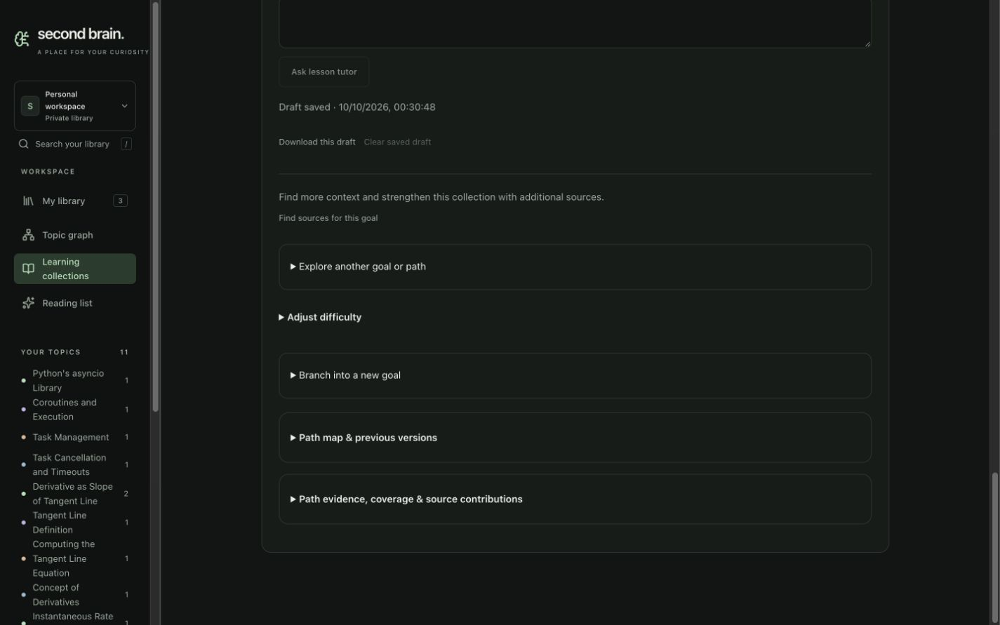
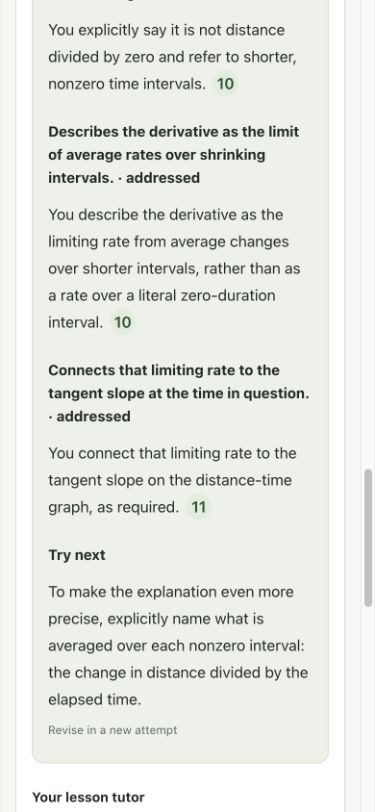
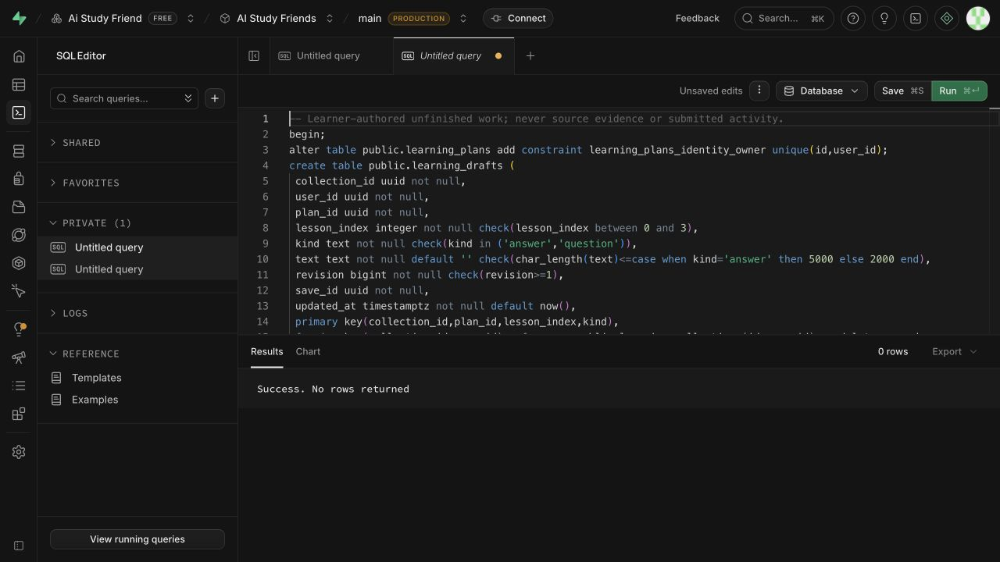

# U2c1 unfinished learning drafts — development acceptance

Date: 2026-10-10, Asia/Singapore. Ticket [#33](https://github.com/CloudKai/secondBrain/issues/33), part of #29. Reviewed starting commit **e914172** on `main`, with substantial unrelated working-tree changes already present. Only the draft unit is included in its commit. Contract: [learning-drafts-contract.md](../planning/learning-drafts-contract.md).

## Verified implementation

Owned answer and question slots are separate for each collection, immutable plan, lesson and lesson scope. The authenticated GET/PUT draft API validates storage ownership and the requested identity. Migration 020 adds an RLS-protected table and checked RPCs. Authenticated users cannot mutate the table directly. A UUID makes a lost-response retry idempotent; stale revisions require explicit conflict resolution. Source changes and removal retain learner-authored text. The recovery SQL disables writes while retaining reads and stored work.

Editors autosave after a 600 ms pause, show save/failure/conflict states, and retain pending text in **tab-private sessionStorage**. Reopening reads and writes cannot overlap. A cloned tab receives at most an independent copy; another tab cannot remove its recovery text. Auth owner changes expire editors, cancel pending work and clear old-owner pending copies. Browser-storage failure shows a memory-only warning. Closing a tab before Saved can discard pending work; confirmed Saved is durable Postgres storage.

Clear writes an empty revisioned slot. Download exports a versioned JSON payload for this draft only. Drafts do not create practice attempts or learning activity. Completed tutor replies remain view-local; U2c2 is a separate target unit.

## Checks and observed behavior

| Boundary | Evidence |
| --- | --- |
| Postgres RPC/RLS | Exact Unicode/whitespace, owner denial, wrong collection/lesson denial, distinct kinds/revisions, idempotent retry, stale writers, text bounds, retained changed/removed source drafts, empty clear and read-preserving rollback pass. |
| Authenticated HTTP | 12 API checks cover missing authentication, read/write/reopen, strict owner/identity/shape validation, input limits and actionable 409 conflicts. The browser client rejects unrelated slots and malformed saved metadata. |
| Browser with isolated HTTP fixtures | Answer/question reload; offline recovery; explicit replace/use-saved; typing during a slow save and lost response; navigation during save; independent lesson drafts; actual same-origin opener clone with copied sessionStorage; storage failure; owner sign-out; retained removed-source drafts; 5,000 Unicode characters pass. No fixture request used live models or data. |
| Export | A browser fixture observed the actual Blob output: format/version, exact text, collection/plan/lesson/kind, revision, status and timestamp. The in-app browser download-event observer timed out; operating-system file completion is **not verified**. |
| Hosted application | Migration 020 ran successfully on AI Study Friends, `rpcclvvcfsxlytosfhxt`, dashboard main Production, without warning or automatic approval rejection. Query text was copied back and matched the reviewed file exactly. |
| Live saved collection | In collection `79b63966-af12-42fb-9574-657c3b0a997b`, goal-branch plan `c5102f68-6457-40f6-9e50-a84216159bf3`, lesson index 1: both temporary test drafts saved and survived reload. Both were then cleared through checked writes. Counters stayed **0 studied, 2 attempts, 2 checks need review**. No answer submission or model call was made. |
| Evidence and keyboard | Enter opened video passage p0011 at **8:17.740–8:30.140**; Escape returned focus to the same citation. Draft wording remained unchanged. Editor/button Tab navigation works. |
| Layout | Measured live desktop **1440×900**, document width 1425, and light narrow **390×844**, document width 375: no horizontal overflow. Original dark appearance and viewport were restored. |

**Workspace validation:** 118 web tests, typecheck, lint and build pass. 311 backend tests pass using the existing project virtual environment. The exact prescribed `uv run --project backend --extra dev pytest backend/tests -q` selects system pytest and fails collection because `langchain_openai` is missing there; the working alternative is `backend/.venv/bin/python -m pytest backend/tests -q`. Vite retains its existing large-bundle warning.

**Isolated HEAD + this unit only:** 105 web tests and 245 backend tests pass, plus web typecheck/lint/build. This verifies that the draft change does not depend on unrelated working-tree features.

## Reviews

Separate standards and spec reviews found a reopen/read race and a shared pending-cache collision. Both were corrected and rechecked with no remaining actionable findings. Cloned-session storage was specifically considered; pending payloads now use sessionStorage itself, without a copied tab token in shared storage.

## Evidence limitations and remaining targets

Actual 200% browser zoom and screen-reader operation remain unverified, as in U2b. A DOM accessibility tree is not a screen-reader run. Native download completion also remains unverified. #33 stays open for these acceptance gates. No existing capture was deleted, no source was sent to a model, and mobile/iOS was not modified in this unit. Library/account export and account recovery remain U5 target work.

The API was restarted with its existing ignored environment file, session 16474 on port 8000. The already-approved worker and Vite were retained. Temporary browser fixtures and tabs were removed. The learner’s existing collection remains open.

## Screenshots

