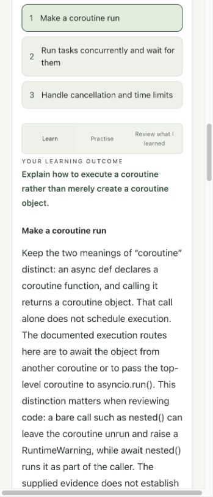
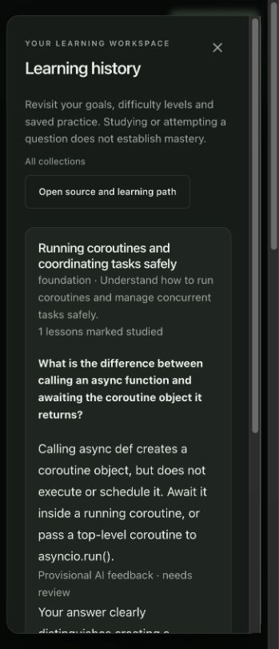
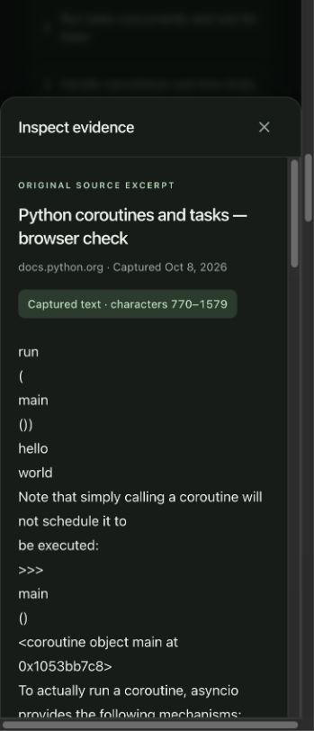
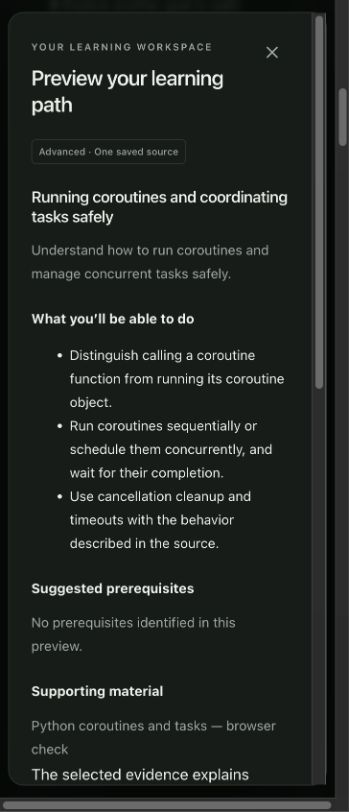
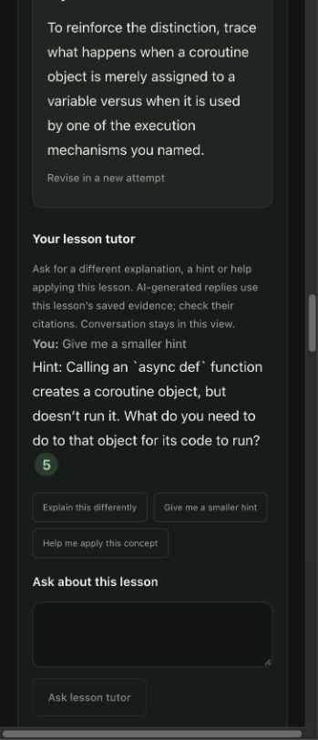
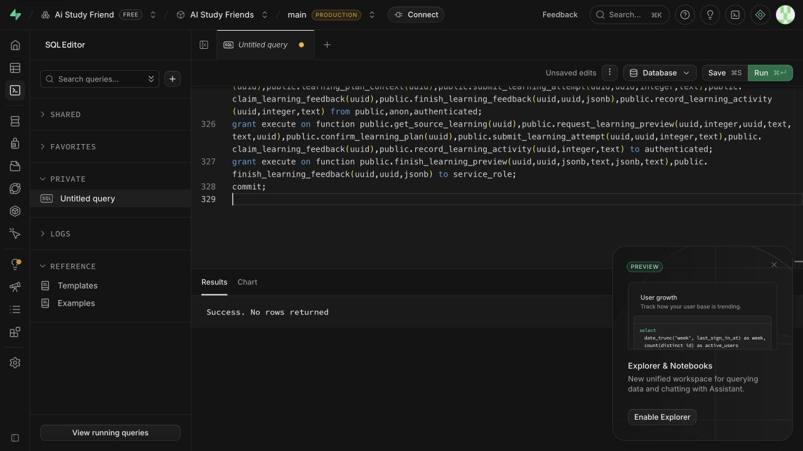

# One-source learning journey — development acceptance, 2026-10-09

Scope: first delivery phase of [#28](https://github.com/CloudKai/secondBrain/issues/28).
The full specification remains open. This is development acceptance, not hosted
public rollout approval or calibrated assessment acceptance.

## Implemented and observed

- Owned source → editable goal → suggested starting paths → transparent outcomes,
  prerequisites, coverage/gaps and optional generated background → explicit start.
- Outcome-driven explanation, attributed example, written understanding check,
  criterion feedback, hints, separate revised attempts and worked answer.
- Free lesson navigation and practice-first controls; lesson tutor and existing
  research discovery entry. Generated teaching is labelled and original notes stay
  read-only.
- Confirmed per-path difficulty variants preserve title/outcomes and retain prior
  attempts. Reload restores the active level and original goal.
- Reading activity is separate from understanding evidence. All AI feedback is
  provisional `needs_review`; the app awards no verified pass or mastery.
- History is reachable from the library. Source changes fence new writes; removal
  retains learner answers and flags unavailable support. Deleted capture reference
  excerpts are cleared, including direct owner table reads.
- Postgres owns immutable plan versions, attempts, activities, idempotency and
  expiring generation leases. RLS and authenticated RPCs enforce ownership;
  server credentials can finish only claimed generated writes.
- Migration 015 applied successfully to development project `rpcclvvcfsxlytosfhxt`.
  Existing source/note tables and capture wording remain unchanged.

## Evidence

### Deterministic checks

- `backend/.venv/bin/python -m pytest backend/tests -q`: **284 passed**.
- `cd web && npm test`: **85 passed**, including real Postgres/PGlite RPC checks.
- `cd web && npm run typecheck`, `npm run lint`, `npm run build`: passed.
  Existing bundle-size warning remains; no release pipeline is claimed.
- `git diff --check`: passed.
- An isolated snapshot containing HEAD plus only this commit's staged changes
  passes web typecheck, all four learning web tests and 18 learning API tests.
  This checks that earlier uncommitted retrieval/presentation work is not required
  to compile the learning commit.
- The prescribed `uv run --project backend --extra dev pytest ...` selected an
  external pytest interpreter without `langchain_openai` and failed collection.
  The project virtual environment command above ran the complete suite instead.

API/HTTP checks cover ownership, explicit confirmation, cached requests, safe
provider failure, at-most-one structural escalation, unknown citations, invalid
path text, busy/limit recovery, preserved source pages/timestamps and saved answers.
RPC checks cover owner-only reads, idempotency, unconfirmed/stale rejection,
difficulty history, late feedback leases, source deletion and cleared excerpts.

### Live development browser

A previously saved public Python asyncio article generated a three-lesson path.
Preview showed source coverage and missing coverage before confirmation. The
learner answer was saved, criterion-specific feedback appeared with citations,
and a tutor hint used current lesson evidence. Revealing a worked answer left
assessment `Needs review`. An advanced variant retained the exact title/outcomes;
after confirmation/reload, the foundation answer and studied activity remained
available in both in-note review and library history.

A lesson citation opened original capture characters 770–1579. Escape returned
focus to its citation button. Narrow teaching controls, previews, practice,
tutor and history were inspected in dark/light themes. Long pages and modal
content remained scrollable. Temporary theme/viewport changes were restored.

OpenAI's authenticated model metadata endpoint confirmed access to both requested
IDs. Learning uses Responses, `reasoning.effort=medium`, `store=false` and structured
output per request: `gpt-6-luna` first, `gpt-6.1-sol` once only for invalid structure
or attribution. An outage does not trigger another costly call. The total model
budget is 100 seconds; client requests time out at 120 seconds. This is a bound,
not a measured latency promise. The live smoke check does not establish semantic
accuracy, calibrated grading or an answer-cost ceiling.

## Remaining acceptance and later phases

- Desktop and actual 200% zoom: the IAB viewport override and zoom shortcuts did
  not affect its measured 364 CSS-pixel window (349px content). These checks are
  **not verified**, despite attempted controls. Full screen-reader checks remain.
- Live PDF/video teaching journeys remain to be exercised; deterministic API
  tests preserve exact PDF page and timed-caption metadata through generation.
- Held-out DeepEval/reviewer evaluation of teaching, alternate valid/partial/
  incorrect answers, difficulty and escalation benefit remains. Semantic
  confidence routing and verified check results stay disabled.
- Measure latency, full request cost and agreed ceiling before public rollout.
- Phase 2: multi-source contributions and confirmed plan revisions.
- Phase 3: retained goal branches, shared understanding and learning graph states.

## Review

**Standards:** two findings (text contract mismatch and generic busy/limit errors)
were fixed and rechecked; no remaining blocking concern in those fixes.

**Spec:** two findings (unreachable deleted-source history and difficulty direction
loss) were fixed and rechecked; no remaining actionable concern in those fixes.
Later-phase requirements are explicitly outside this first implementation unit.

## Screenshots

