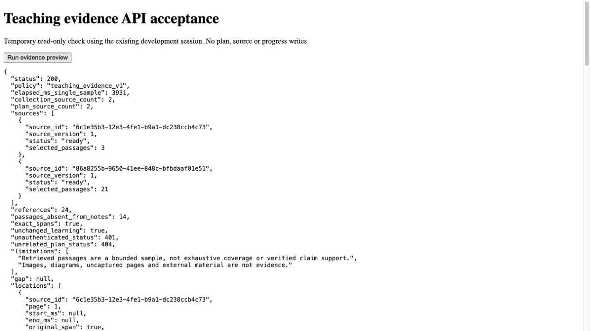

# U3a1 teaching evidence preview acceptance

Date: 2026-10-10, Asia/Singapore. Delivery [#35](https://github.com/CloudKai/secondBrain/issues/35),
part of [#29](https://github.com/CloudKai/secondBrain/issues/29).
Contract: [teaching evidence preview](../planning/teaching-evidence-preview-contract.md).
Reviewed base: `cbd9133eb8495fd4ce609e5f99004ca258a4884a` on `main`, plus the scoped
unit patch. Substantial older dirty/untracked work exists and remains separate.

## Implemented in development

An owned read-only collection/plan evidence API searches the confirmed path's
participating captured sources using the existing BM25+dense RRF index. It returns
exact `LearningEvidence` passages from original captures rather than limiting
selection to saved-note references. Policy `teaching_evidence_v1` limits scope to
eight sources, 24 passages, 16,000 excerpt characters and a 35-second selection deadline.

Unready sources require explicit partial coverage choice; no ready indexes fails
safely. No matches produces an evidence gap. The response reports participating
versus collection sources, readiness, selected passage counts and sampling/capture
limitations. Retrieved similarity is not claim support or exhaustive coverage.
Ownership, source versions, capture hashes, index generations and page/time spans
are validated; participating inventories and collection membership are rechecked
after retrieval. Failures do not alter confirmed lessons or learning history.

No new migration was applied. Accepted retrieval prerequisites 013/014 and their
existing helper methods are included with this unit for a clean checkout. Query
policy constants have a small query module so the query client does not import
the background indexer. The existing uncommitted indexer and its immutable policy
values remain unchanged. No generation model changed.

## Tests

| Check | Result |
| --- | --- |
| New authenticated API/external HTTP cases | 20 pass; route initially returned 404 before implementation |
| Actual Postgres public RPC seams | 2 pass; inventory/readiness, capture loading, owner denial, index generation invalidation, removal and retained history |
| Workspace backend | 344 pass using `backend/.venv/bin/python -m pytest backend/tests -q` |
| Workspace web | 126 pass using `cd web && npm test` |
| Isolated base plus this unit | 278 backend / 113 web pass |
| Workspace and isolated web typecheck/lint/build | Pass |
| Diff whitespace | Pass |

Cases include article/PDF/transcript details omitted from a note, physical page 6,
13–18-second caption locations, Unicode formulas, fair multi-source bounds,
unready/empty results, malformed ownership/generation/hash/locations, stale
captures/plans/indexes, unrelated/unconfirmed plans, unauthorized requests and
provider outage. No tests call real generation or storage services.

The exact prescribed `uv run --project backend --extra dev pytest backend/tests -q`
first lacked sandbox access to its cache; with cache access it selects system
pytest and fails collection with missing `langchain_openai` (23 errors). The existing
project virtual environment passes all tests. Runner configuration remains separate
work; this is not a failing application test. Workspace build retains the previous
721.46 kB chunk warning; the isolated unit bundle is 477.99 kB.

## Live read-only acceptance

Used the existing local learner session against the configured hosted Supabase,
OpenAI embedding service and Qdrant. Source text was not sent to a generation
model. Temporary harness used normal application HTTP and never displayed credentials.

Collection `79b63966-af12-42fb-9574-657c3b0a997b`, confirmed goal branch
`c5102f68-6457-40f6-9e50-a84216159bf3`. Query:
“Explain why instantaneous velocity is a limit of average rates over progressively
shorter intervals.”

- HTTP 200, policy `teaching_evidence_v1`, both participating sources indexed.
- 24 passages: 3 from the PDF, 21 from the transcript; 14 absent from their note references.
- Every original Unicode span, source version, PDF page and caption time validates
  against the current capture using the existing browser reference validator.
- PDF physical pages 1/2; transcript locations retained, including 3:17.180–3:25.640.
- Complete learning snapshot identical before/after, with 0 studied / 2 attempts /
  2 provisional checks still shown in the user's workspace.
- Unauthenticated request 401; plan under an unrelated collection 404.
  Cross-owner denial was exercised through API mocks and actual Postgres RPCs,
  rather than creating a second hosted account.
- Single preview response 3,931 ms. This does not measure answer latency,
  first verified teaching text, percentiles or 200-source capacity.

An initial harness mistakenly used GET on a POST-only study route and received 405;
no writes occurred. The corrected run reads saved notes from the existing studies
list and is the result recorded above. Harness files and its tab were removed;
the user's original learning tab, theme, selected lesson and draft remain intact.
API restarted with ignored env file on port 8000; approved worker and Vite retained.

Sanitized response measurements: [live result](assets/teaching-evidence-2026-10-10/live-result.json).

## Reviews and limits

### Standards

Separate read-only standards review found no actionable hard breaches or material
Fowler smells in the scoped unit and required retrieval prerequisites.

### Specification

Separate read-only contract review found no actionable missing, incorrect or
unrequested behavior. Both reviews covered the actual unit patch; validation
results above are independent of those reviews.

U3a1 is accepted as an evidence-selection foundation. **Target work remains:**
independently reviewed teaching cases before changing generation; versioned
concept/coverage manifests; outcome-specific lesson generation/persisted evidence;
stable outcome/check IDs; useful criterion feedback and next actions. Existing
lessons still use saved-note evidence. There is no new user-facing evidence control
in this unit. U2's actual zoom/screen-reader/native-download gates stay open; no new
UI was introduced or claimed accessible here. No mobile/iOS, push or TinyFish work.

## Recovery

Remove the evidence router inclusion to disable new previews; no new data needs
rollback and saved plans remain readable. Keep retrieval prerequisites while this
route is enabled. Any prerequisite rollback must first disable this route and its
other consumers. Missing prerequisites fail with 503, never with unvalidated evidence.
