# Saved-source learning journey audit — 2026-10-06

## Scope and evidence

Current local web UI and API, real development Supabase storage and OpenAI worker. Separate anonymous browser library initially had zero sources. The learner explicitly approved running the worker during the audit; it was stopped afterward (exit 0). No TinyFish used. No application code changed and no automated tests added or run in this audit.

Public sources imported through the product UI:

- PDF: https://arxiv.org/pdf/1706.03762 — source `31def190-a47f-4162-bb30-dd2a7d270b63`.
- Article: https://nlp.seas.harvard.edu/annotated-transformer/ — source `59e40b0e-dd53-4a88-a778-63fe06467683`.
- Video captions: https://www.youtube.com/watch?v=eMlx5fFNoYc — source `fa719934-7fcb-43d4-8d1f-12a81dbf138d`.

All screenshots below were captured, saved and visually inspected in this run. Actual PDF/video locator labels were inspected; outbound playback/page rendering was not checked. Three audit sources are retained for follow-up; no learner data was deleted. Dark appearance restored and temporary viewport override reset. Web/API remain available locally.

Initial library 503 was resolved by restarting the existing API with `--env-file backend/.env`. The documented uv command selected an incompatible global Python environment; the existing backend virtualenv was used. A broader diagnostic metadata read was rejected by automatic approval review because it was not restricted to audit sources. It was not executed or bypassed; UI evidence establishes the blockers below.

## Findings and next units

1. **High: citation support mismatch.** The PDF’s positional-encoding paragraph cites an unrelated page-5 passage. Add this case to the planned DeepEval baseline and deterministic citation checks; exact offsets alone cannot establish support.
2. **High: missed answer in captured evidence.** The current-note assistant cannot answer the positional-encoding question although page 6 has the explanation. This motivates the approved full-capture retrieval direction; hybrid retrieval remains planned.
3. **High: generation reliability.** Video notes succeeded, but video topic mapping failed after a manual retry and combined synthesis failed. Diagnose safe provider/validation error codes and support contracts in a separate backend unit before claiming the journey complete.
4. **Medium: graph label wrapping.** Long topic labels break inside ordinary words on phone width. Use structure-aware label layout and enough node space; also inspect compact maps against long labels.
5. **Remaining acceptance:** successful combined-overview and archived-version citations, supported edge corrections, actual browser zoom, complete keyboard/screen-reader coverage, upload/provider fallback cases and rendered contrast. New sources have no archived versions; creating an artificial revision was outside this audit. No successful combined overview or connection was available.

**Outcome:** slice 4 audit completed with named blockers. UX implementation tickets #21–#23 remain open; broader acceptance is incomplete. AI baseline/retrieval slice 5 has not started. Do not treat sampled UI checks as AI accuracy, production or full accessibility acceptance.

## Numbered journey

### 1. Capture and generation

**Health:** Working. Public arXiv PDF saved all 15 physical pages, then generated a read-only note. Harvard article capture used a page reader and disclosed unconfirmed completeness. Live YouTube publisher-provided English captions imported; all three notes became ready.

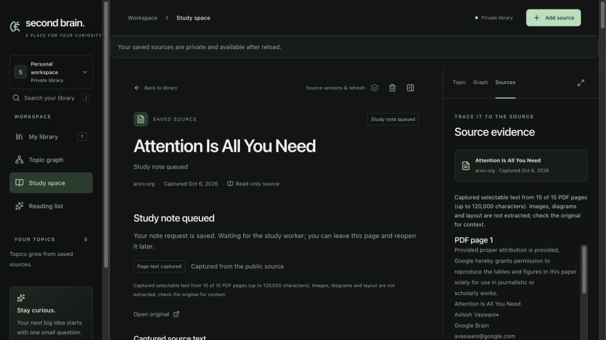

### 2. Read the PDF note

**Health:** Working presentation; AI support concern. Generated overview, concepts, recall and compact circular citations are readable. Citation presence does not establish semantic support.

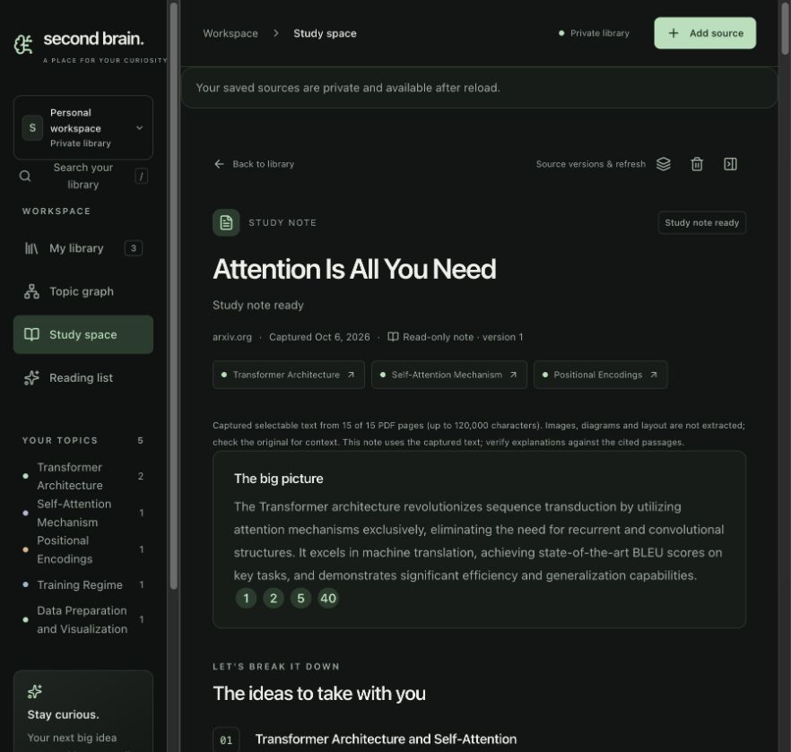

### 3. Inspect a PDF citation

**Health:** Working locator; mismatched support. Citation p0020 opens exact captured PDF page 5 and an original link with #page=5. It is cited by the positional-encoding paragraph but discusses feed-forward layers and embeddings, not that paragraph’s positional-encoding claim. Escape restores focus to p0020.

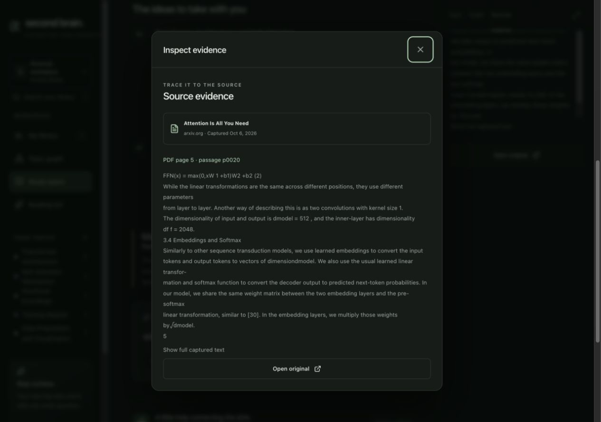

### 4. Ask the current note

**Health:** Retrieval gap. “Why does the Transformer use positional encodings?” returned an evidence gap. The captured PDF page 6 explicitly explains sequence order. This is a missed retrieval/support opportunity, not evidence that the PDF lacks the answer.

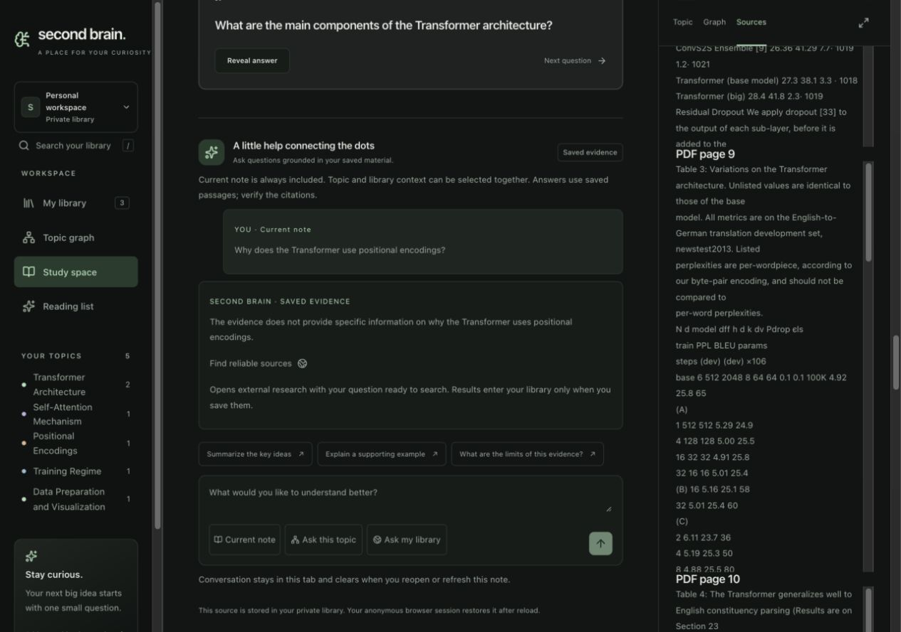

### 5. Ask topic and library together

**Health:** Working sampled path. Both scope buttons remained selected. The answer used PDF and Harvard article citations and disclosed bounded omissions. This single answer is not a retrieval benchmark.

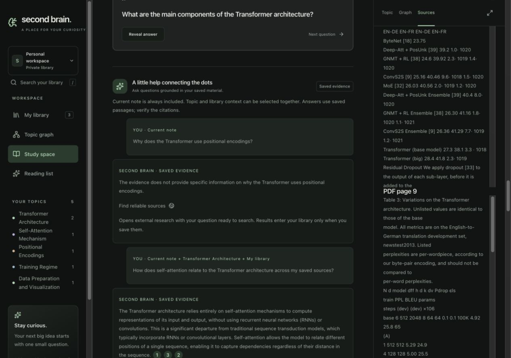

### 6. Inspect cross-source assistant evidence

**Health:** Working. Harvard passage p0012 opens over the PDF note; the note route remains unchanged. The passage supports the inspected self-attention claim. Escape returns focus to that assistant citation.

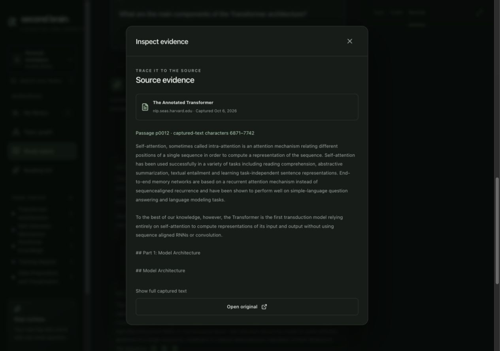

### 7. Handle changing evidence

**Health:** Working recovery. The first unsupported question was blocked because evidence changed during processing. The UI retained the question and offered Retry question; retry succeeded.

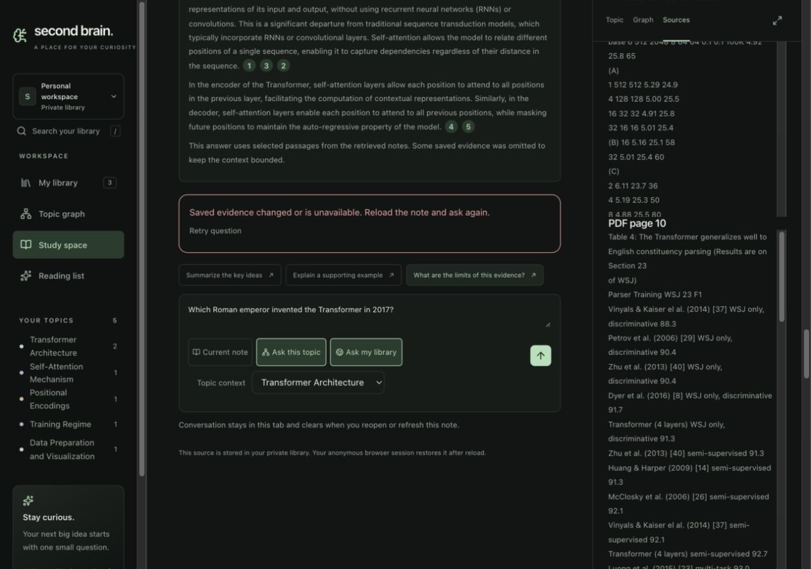

### 8. Handle an unsupported question

**Health:** Working sampled path. The Roman-emperor question returned an evidence gap without invented citations. External research is offered as a deliberate action, without automatically saving or searching.

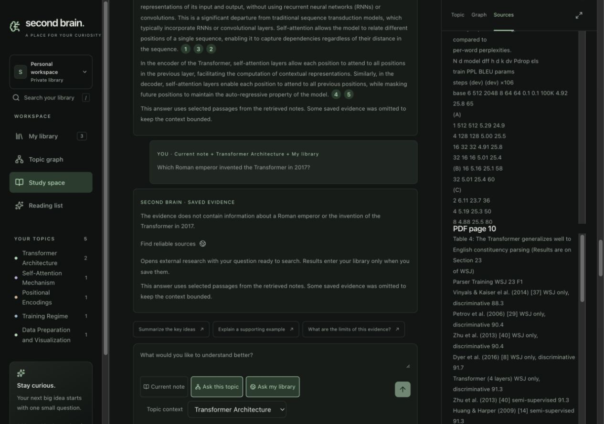

### 9. Inspect timed video evidence

**Health:** Working. At 390×844, p0064 opens a visible bottom drawer with supplied 9:29.200–9:35.780 cue bounds and YouTube t=569s link. Tab moves from Close to full text; Escape returns focus to p0064. Link construction was inspected; actual playback seeking was not tested.

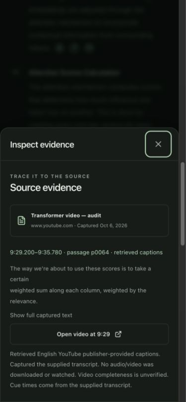

### 10. Organize saved topics

**Health:** Blocked generation; label issue. PDF and article share Transformer Architecture. Video topic mapping failed, and failed again after one manual retry. Five topics and zero connections are honestly displayed. “Self-Attention Mechanism” breaks into an isolated final letter at this width; improve node sizing/wrapping.

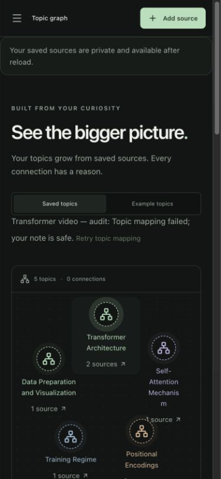

### 11. Correct a topic title

**Health:** Working sampled correction. Renamed the audit-library topic to Transformer Architecture (audit), verified UI success, then restored Transformer Architecture. Original source notes stayed available. Merge, reassignment and accept/reject connection writes were not exercised.

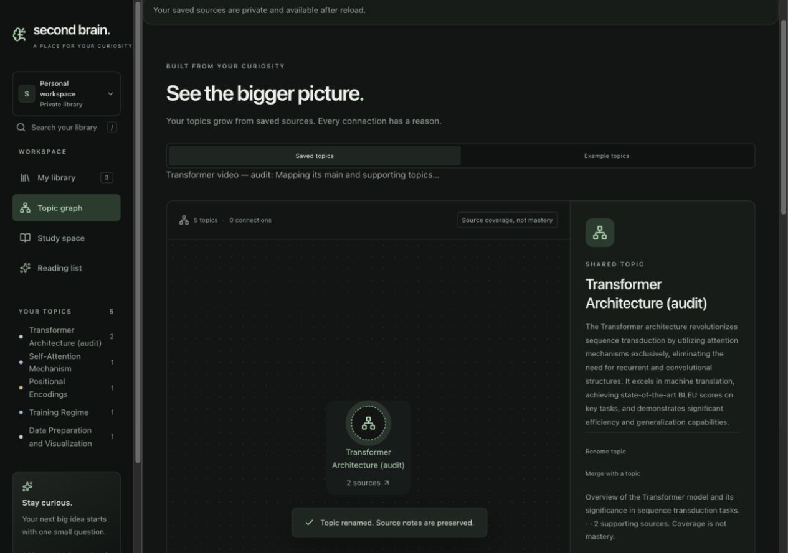

### 12. Validate import fields

**Health:** Working sampled paths. Submitting an empty article focuses its required URL. A selected PDF range with empty inputs was collapsed before submit: native validation reopened the disclosure and focused First page. Narrow actions remain reachable while fields scroll. No invalid source was saved.

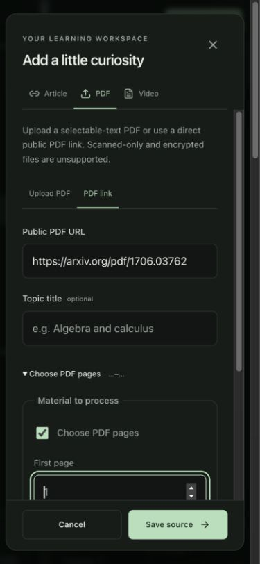

### 13. Inspect light appearance

**Health:** Working sampled layout. Wide light library displays three saved sources, five topics, source filters and resume. Restored dark appearance afterward. Full rendered contrast and screen-reader acceptance remain unverified.

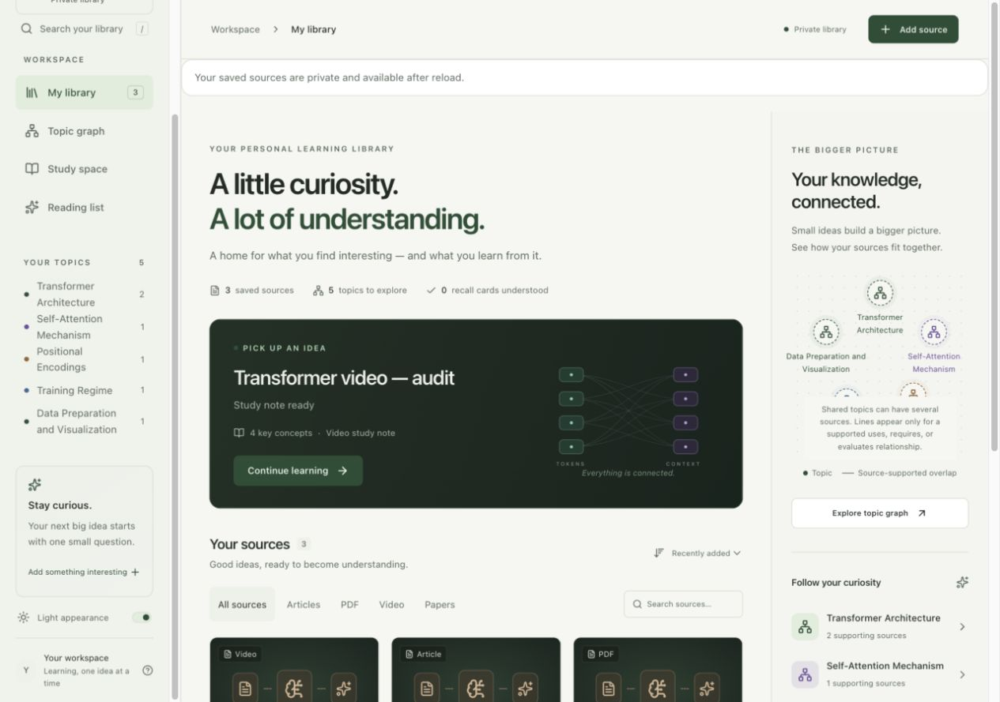

### 14. Inspect constrained reflow

**Health:** Working; zoom limit. At 640×450 the import body scrolls and actions remain visible. This is a constrained-viewport check, not an actual browser 200% zoom test.

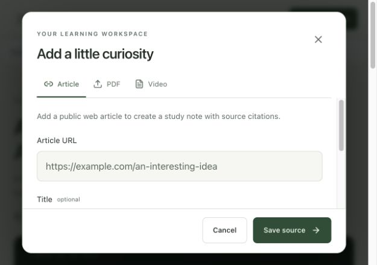

### 15. Inspect topic-branch evidence

**Health:** Working. Harvard p0012 opens while #topics remains the route. Escape returns focus to the topic-branch citation. Combined-overview citations could not be exercised.

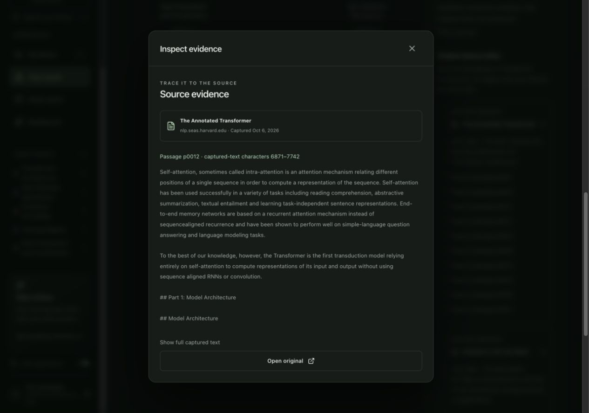

### 16. Inspect connections

**Health:** Acceptance unavailable. No supported edges were generated in this library. Connection interaction/correction could not be checked using these real sources; no artificial edges were inserted.

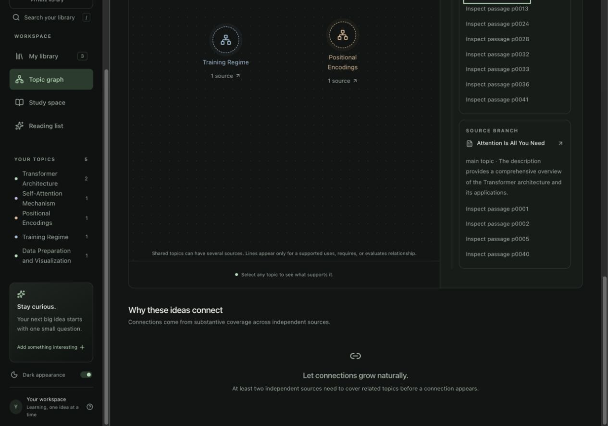

### 17. Inspect combined synthesis

**Health:** Blocked. Combine was requested and processing observed. Topic rename/restore invalidated an earlier attempt; a current request ultimately showed Synthesis could not complete, with preserved original notes and Retry overview. Successful combined-overview citations remain pending.

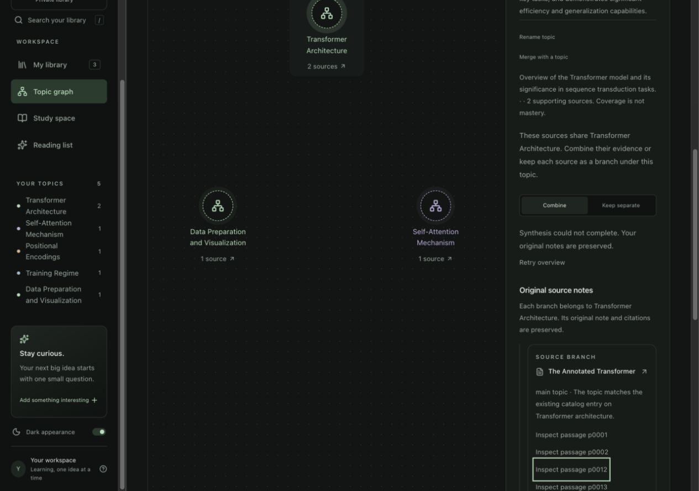

## Fix implementation follow-up — 2026-10-06

**Confirmed diagnosis:** a read-only generation replay restricted to the three
public audit sources reproduced `Conflicting canonical context` for the video
mapping and `Combined claims need evidence from independent sources` for the
shared overview. It did not mutate saved notes, mappings or overviews.

**Implemented locally, acceptance pending:**

- Topic prompts require exact catalog context and unique canonical matches.
  Topic and overview drafts get one correction attempt with validation feedback
  under the same 65-second deadline. Both attempts retain the original hard
  ownership-independent evidence/identity/support-contract validation.
- Long-note synthesis receives exact original excerpts alongside checkpoint
  summaries, fairly allocated across sections within a 60,000-character budget.
  Summaries guide coverage; the model is instructed to omit claims lacking support
  in supplied excerpts. This reduces a support failure mode; it is not a semantic
  grounding guarantee or a completed DeepEval baseline.
- Assistant passage selection includes full captured text within the existing
  selected-source scope. Exact stored references are validated, new passages use
  an independent locator namespace, and page/caption bounds are preserved. Token
  matching handles punctuation; the 30,000-character answer context remains.
  Cross-source candidate selection is unchanged; shared BM25/semantic retrieval
  remains planned.
- Graph label boxes have explicit widths and wrap at normal word boundaries.

**Checks:** Python syntax parse, web typecheck and lint passed. Focused regression
and browser acceptance are awaiting the requested test-scope approval. Existing
saved audit notes and failed jobs have not been rewritten or retried. No worker
was restarted, no migration applied, and no native/iOS files changed. #24 stays
open until real-source rechecks and any needed saved-note repair are complete.

## Learner-directed cleanup and next unit

After the fix implementation, the learner authorized deleting existing audit
material and using fresh sources instead. The three exact audit source IDs above
were deleted with a one-owner filter. The deletion returned three rows and a
follow-up exact-ID read returned zero. Other library sources were not targeted.
The retained-source statements earlier in this report describe the earlier audit
state. Existing-note repair is now superseded; this cleanup is not evidence that
the local fixes pass. #24 remains open for fresh-source acceptance.

[GitHub #25](https://github.com/CloudKai/secondBrain/issues/25) records the next
unit, development DeepEval baseline preparation, with 12 seed cases and explicit
measurement gates. No fresh captures, semantic scores or worker restart yet.
